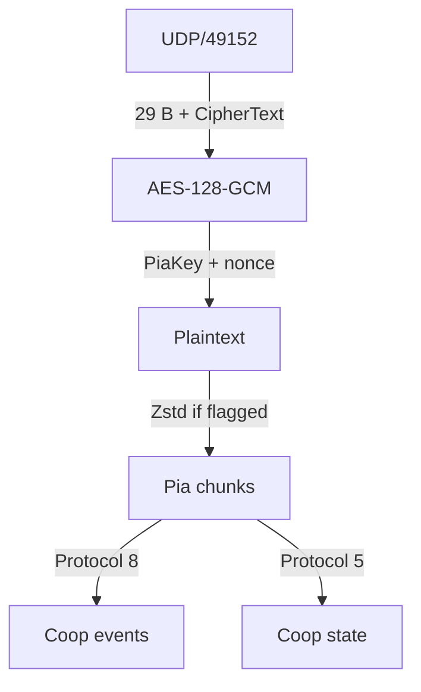

# Packet

オオモノシャケやアイテムの生成通知、WAVEや仲間の状態更新には、`CoopEnemySpawnNetEvent`、`CoopItemSpawnEvent`、`CoopSequenceNetState`など、`Coop`で始まる型名が使われます。ここではこれらをCoop通信と呼びます。

本章ではCoop通信のプロトコルについて解説します。

## パケット構造 {#packet-layout}

プライベートバイトのゲーム中の通信は、UDP 49152でやり取りされます。共通の構造を保存したUDPペイロードで示します。Hex Viewのビット位置はUDPペイロードの先頭から数えます。

<PacketHexExample kind="packetLayout" />

`Flags`には末尾のパディング長とZstd圧縮の有無が入ります。nonceは送信元IPv4アドレスの4バイトと、`Nonce Suffix`の8バイトを連結した値です。本文は部屋ごとの`PiaKey`で認証・復号し、必要ならZstdで展開します。`PiaKey`の計算方法は[Key](/protocol/key.html)にあります。

UDP payload to Coop messages.

復号後には複数のPiaチャンクが入ることがあります。各チャンクには`Protocol`番号、長さ、本文があり、省略された欄は前のチャンクの値を引き継ぎます。以下のHex Viewは、チャンクのヘッダーを除いた`Protocol`ペイロードを表示します。

## `BroadcastEventProtocol` {#event-layout}

[Type](/protocol/type.html#protocol-8)

待機中のステージとキケン度は[`PrivateSetting`](/protocol/index.html#private-setting)で更新されます。WAVE開始前には、ホストからクライアントへ別の`OnlineCoopSetting`が届きます。

### `OnlineCoopSetting` {#online-coop-setting}

| パラメータ | 意味 |
| --- | --- |
| `Stage Resource` | `Cop_*`名。[対応表](/ids/index.html#stages)から`StageId`を求めます |
| `JobType` | バイトの種類を示します |
| `Difficulty` | 難易度。通信値から`1`を引いて求めます |
| `GameSeed[0]`～`GameSeed[3]` | 32ビット整数×4の`GameSeed`です |
| `Unknown` | 用途を確定できていない欄 |
| `GameFrame`・`LifeNumber` | 本文の後に付くゲーム内の値 |

<PacketHexExample kind="onlineCoopSetting" />

通信の`GameSeed`をシーン側へ条件付きで転送する処理があります。保存したプレイで実際に転送され、後から上書きされなかったかは未確認です。[WAVE 情報](/wave/index.html)で計算できる範囲を説明します。`GameSeed`の構成とシーンへの転送条件は[Splatoon 3の`GameSeed`](/prng/game-seed/sp3.html)で説明します。

### `CoopEnemySpawnNetEvent` {#enemy-spawn-event}

| パラメータ                      | 意味                                     |
| ------------------------------- | ---------------------------------------- |
| `Spawn X`・`Spawn Y`・`Spawn Z` | 敵の生成要求位置                         |
| `SalmonId`                      | `CoopEnemyInfo.Type`に対応する敵種       |
| `GameFrame`                     | 通知に付くゲーム内のフレーム値           |
| `LifeNumber`                    | 通知に付く値。ゲーム内の意味は未確認です |

`SalmonId`の値と名前は[対応表](/ids/salmon-id.html)で確認できます。

<PacketHexExample kind="enemySpawn" />

一部のオオモノの生成要求位置は、ステージの出現地点候補と整合します。タワーなどは専用の地点処理を使います。

### `CoopItemSpawnEvent` {#item-spawn-event}

| パラメータ | 意味 |
| --- | --- |
| `Spawn X`・`Spawn Y`・`Spawn Z` | アイテムの生成要求位置 |
| `Transform Value` | 座標変換に関わる値。`0`なら先頭のXYZをそのまま使う経路があります |
| `Link Byte`・`Link Nibble` | 後続の取得応答と結ぶ対応値の構成要素 |
| `Link Bits` | `Link Nibble`と一致する例があります。ゲーム内での意味は未確認です |
| `Other X`・`Other Y`・`Other Z` | 別の座標。用途は未確認です |
| `GameFrame` | 通知に付くゲーム内のフレーム値 |
| `LifeNumber` | 通知に付く値。ゲーム内の意味は未確認です |

確認した通信では`Link Nibble`を24ビット左へずらして`Link Byte`を加えると、後続の取得応答の`Link Value`と一致します。

<PacketHexExample kind="itemSpawn" />

### `CoopItemResponseGetByPlayerEvent` {#player-get-event}

| パラメータ   | 意味                                                    |
| ------------ | ------------------------------------------------------- |
| `Link Value` | 先に届いたアイテム生成通知との対応値                    |
| `Value + 1`  | 元の値に`1`を加えて記録した値。元の値の意味は未確認です |
| `Unknown`    | 用途未確認の値                                          |
| `GameFrame`  | 通知に付くゲーム内のフレーム値                          |
| `LifeNumber` | 通知に付く値。ゲーム内の意味は未確認です                |

<PacketHexExample kind="playerGet" />

### `CoopItemResponseGetByEnemyEvent` {#enemy-get-event}

| パラメータ   | 意味                                     |
| ------------ | ---------------------------------------- |
| `Link Value` | 先に届いたアイテム生成通知との対応値     |
| `Unknown`    | 用途未確認の値                           |
| `GameFrame`  | 通知に付くゲーム内のフレーム値           |
| `LifeNumber` | 通知に付く値。ゲーム内の意味は未確認です |

<PacketHexExample kind="enemyGet" />

### `CoopItemGoldenIkuraShotEvent` {#golden-ikura-shot-event}

| パラメータ | 意味 |
| --- | --- |
| `XYZ A X`・`XYZ A Y`・`XYZ A Z` | `1`組目の座標。射出中の役割は未確認です |
| `Vector A`・`Vector B` | 空間ベクトルの方向に由来する値 |
| `Vector Length` | 空間ベクトルの大きさに由来する値 |
| `XYZ B X`・`XYZ B Y`・`XYZ B Z` | `2`組目の座標。射出中の役割は未確認です |
| `Value + 1` | 元の値に`1`を加えて記録した値。用途は未確認です |
| `GameFrame` | 通知に付くゲーム内のフレーム値 |
| `LifeNumber` | 通知に付く値。ゲーム内の意味は未確認です |

<PacketHexExample kind="goldenShot" />

### `CoopItemGoldenIkuraDirectBankEvent` {#golden-ikura-direct-bank-event}

| パラメータ | 意味 |
| --- | --- |
| `Value + 1` | 元の値に`1`を加えて記録した値。金イクラの個数や納品したプレイヤーを示すかは未確認です |
| `GameFrame` | 通知に付くゲーム内のフレーム値 |
| `LifeNumber` | 通知に付く値。ゲーム内の意味は未確認です |

<PacketHexExample />

## `UnreliableProtocol` {#state-layout}

[Type](/protocol/type.html#protocol-5)に、確認した状態の型を載せています。

### `CoopSequenceNetState` {#wave-state}

| パラメータ | 意味 |
| --- | --- |
| `Frame Mode` | 明示的なフレーム形式を示す値 |
| `Frame Length` | フレームの長さ |
| `Group ID` | `1104`。ホストからクライアントへ送信 |
| `Present` | 状態の有無 |
| `Sequence` | WAVE進行に関わる値。画面のWAVE番号との対応は未確認です |
| `Quota` | 適用ノルマの値 |
| `Baseline A`・`Baseline B` | 集計の基準値。現在の金イクラ数かは未確認です |
| `Flag` | 用途未確認のフラグ |
| `Unknown` | 後続フレームの値。ここでは意味を確定していません |

<PacketHexExample kind="sequence" />

### `CoopSeqPlayerNetState` {#players}

| パラメータ | 意味 |
| --- | --- |
| `Group ID` | `1107`はホストからクライアント、`1108`はクライアントからホスト |
| `Present` | 状態の有無 |
| `Unknown` | 意味を確定していない値 |
| `Array A Count`・`Array B Count` | それぞれの配列に含まれる値の件数 |
| `Array A [0]`～`Array A [3]`、`Array B [0]`～`Array B [3]` | 参加者との対応とゲーム内での意味は未確認です |

<PacketHexExample kind="playerState" />

## 参考資料 {#references}

- ELF
- ステージデータ
- LAN Play通信
