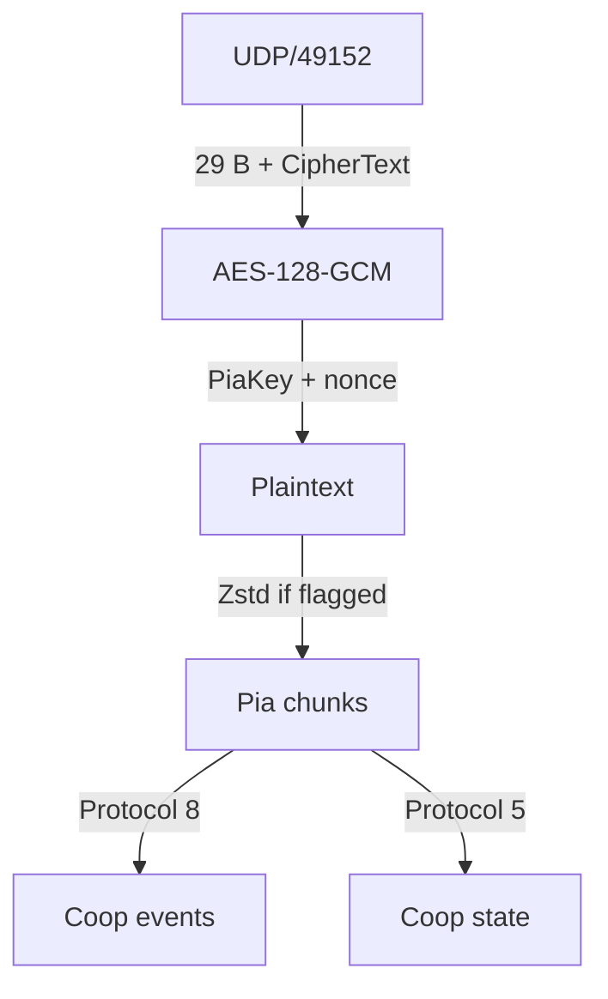

# Packet

オオモノシャケやアイテムの生成通知、WAVEや仲間の状態更新には、`CoopEnemySpawnNetEvent`、`CoopItemSpawnEvent`、`CoopSequenceNetState`など、`Coop`で始まる型名が使われます。本ページではこれらを**Coop通信**と呼び、パケット構造と各型の本文を解説します。

## パケット構造 {#packet-layout}

プライベートバイトの試合中の通信は、UDP 49152で送受信されます。以下は共通のUDPペイロード構造です（ビット位置はUDPペイロード先頭が起点）。

<PacketHexExample kind="packetLayout" />

`Flags`には末尾のパディング長とZstd圧縮の有無が入ります。nonce（12バイト）は送信元IPv4アドレス（4バイト）と`Nonce Suffix`（8バイト）を連結した値です。暗号文は部屋ごとの`PiaKey`（導出方法は[Key](/protocol/key.html)参照）でAES-128-GCMにより認証・復号し、圧縮フラグが立っていればZstdで展開します。

復号後の平文には複数のPiaチャンクが含まれる場合があります。各チャンクは`Protocol`番号、長さ、本文を持ち、省略されたヘッダー欄は直前のチャンクの値を引き継ぎます。以降のHex Viewでは、Piaチャンクのヘッダーを除いた`Protocol`ペイロード（または明示した型付き本文）を表示します。

## `BroadcastEventProtocol` {#event-layout}

登録型の一覧は[Type](/protocol/type.html#protocol-8)を参照してください。

待機中のステージとキケン度は[`PrivateSetting`](/protocol/index.html#private-setting)で更新され、WAVE開始前にはホストからクライアントへ`OnlineCoopSetting`が届きます。

標準の型付き通知形式では、復号後の`Protocol`ペイロードのbyte 17–20に配送先の`Group ID`、byte 21–24に型ID（いずれもリトルエンディアン）が入ります。なお、`Protocol` 8には外側ヘッダー長が異なる形式もあるため、先に形式とメッセージ長を照合してから各フィールドを読みます。

### `OnlineCoopSetting` {#online-coop-setting}

| パラメータ | 意味 |
| --- | --- |
| `Stage Resource` | `Cop_*`名。[対応表](/ids/index.html#stages)から`StageId`に変換 |
| `JobType` | バイトの種類 |
| `UnlockedSeason` | `通信値 - 1`。ブキ候補のSeason上限 |
| `WeaponId Count`・`WeaponId[0]`～`WeaponId[3]` | 固定ブキ配列の要素数（最大4）と各要素。`WeaponId`は`通信値 - 3` |
| `ScenarioAppVersion` | シーンの同名値に対応する32ビット値。`IsUseScenario`が有効な場合に装備候補の分岐で使用 |
| `ScenarioCompetitionType` | スペシャル再配置の判定条件の一つ |
| `ScenarioOriginalWeaponIdArray Count` | スペシャル再配置で比較する元ブキ配列の要素数 |
| `Difficulty` | 難易度（`通信値 - 1`） |
| `GameSeed[0]`～`GameSeed[3]` | 128ビットの`GameSeed` |
| `Unknown` | 用途未特定の欄 |
| `GameFrame`・`LifeNumber` | 本文末尾に付くフレーム値と世代値 |

表示中の211バイト形式（型ID `0x9a1e036d`）では、復号後の`Protocol`ペイロードのbit 725–727がブキID配列の要素数、bit 728から各要素（16ビット、最大4枠、未使用枠はゼロ埋め）が並びます。固定ブキのIDが入り、`-1`の枠は各WAVEのブキ抽選（[WAVE 情報](/wave/index.html#weapons-specials)参照）へ進みます。

また、bit 1559–1590が`ScenarioAppVersion`（分岐条件は[InternalValue](/internal-value.html)参照）、bit 1591が`ScenarioCompetitionType`、bit 1592–1594が`ScenarioOriginalWeaponIdArray`の要素数です。`ScenarioOriginalWeaponIdArray`（計67ビット、各要素は`WeaponId + 3`の16ビット値、未使用枠はゼロ埋め）は、スペシャル再配置時に現在のブキ配列と比較されます。なお、前段の可変長配列の要素数によって絶対ビット位置は変化します。

この通知は`VersusSetting`のハンドラー`1`のイベントとして処理され、次のシーン設定へコピーされます。

<PacketHexExample kind="onlineCoopSetting" />

`GameSeed`の取得方法とシーンへの転送条件は[Splatoon 3の`GameSeed`](/prng/game-seed/sp3.html)、計算可能な範囲は[WAVE 情報](/wave/index.html)を参照してください。

### 装備と使用通知 {#equipment-events}

射撃・発動イベントの型から、使用したブキの系統やスペシャルの種類を判別できます。

| 通知型 | 確認できる種類 |
| --- | --- |
| `PlayerNetEvent::BulletCharger` | チャージャー系の射撃 |
| `PlayerNetEvent::BulletSlosher` | スロッシャー系の射撃 |
| `PlayerNetEvent::BulletManeuver` | マニューバー系の射撃 |
| `PlayerNetEvent::BulletSpShockSonar` | ホップソナー |
| `PlayerNetEvent::ChariotStart`・`BulletSpChariotCannon` | カニタンク |
| `PlayerNetEvent::BulletSpTripleTornadoMother`・`BulletSpTripleTornadoGuide` | トリプルトルネード |

具体的なブキ・スペシャルのIDは、[攻撃通知の`DamageReason`](#attack-event)や[ユーザー設定](/packet/versus-user-setting.html)（入室時の所持装備）から確認できます。

### `CoopEnemySpawnNetEvent` {#enemy-spawn-event}

| パラメータ | 意味 |
| --- | --- |
| `Spawn X`・`Spawn Y`・`Spawn Z` | 敵の生成要求位置 |
| `SalmonId` | `CoopEnemyInfo.Type`に対応する敵種（[対応表](/ids/salmon-id.html)参照） |
| `Spawn Direction Raw` | 本文内の圧縮方向（21ビット） |
| `Predicted Slot` | 送信側が計算したプールの次スロット番号（4ビット） |
| `Spawn Frame Raw` | 本文内のフレーム通信値（20ビット） |
| `Array Count` | 後続する32ビット値配列の要素数（最大10件） |
| `Pool Selector + 1` | 受信側で選ぶ敵プールindexに`1`を加えた値（8ビット） |
| `GameFrame` | 通知末尾のゲーム内フレーム値（23ビット） |
| `LifeNumber` | 通知末尾のactor世代照合値（4ビット） |

<PacketHexExample kind="enemySpawn" />

型IDは`0x0caefc01`、表示中の形式は89バイト（型付き本文481ビット）です。一部のオオモノの生成要求位置はステージの出現地点候補と一致します（タワーなどは専用の地点処理を使用）。

型付き本文のbit 51–71が`Spawn Direction Raw`、bit 72–75が`Predicted Slot`、bit 76–95が`Spawn Frame Raw`、bit 96–127が`Unknown`（32ビット）、bit 128–132が`SalmonId`です。bit 133–140の`Pool Selector + 1`（`通信値 - 1`、通信値`0`は`-1`）は、送信側が敵の生成順番号を入れ、受信側が敵プールの選択に使います。Enemy用resolverの特定経路では、種別`2`かつ番号`s >= 0`のときに配送先候補`2,000,000 + 10,000 × s`を導出します（生成通知自体の`Group ID`とは別）。bit 141–144の`Array Count`の後には、32ビット値×10枠（計320ビット、未使用枠はゼロ埋め）が続きます。

### `CoopEnemyStateEvent` {#enemy-state-event}

敵の状態コードと、状態切替が有効になるフレームを通知します。型IDは`0x4c1ecd54`、表示中の形式は32バイト（`Protocol`ペイロードのbit 200から型付き本文26ビット）です。

| パラメータ         | 意味                                     |
| ------------------ | ---------------------------------------- |
| `State + 1`        | 状態コードに`1`を加えた値（6ビット）     |
| `Transition Frame` | 状態切替が有効になるフレーム（20ビット） |
| `GameFrame`        | 通知末尾のゲーム内フレーム値             |
| `LifeNumber`       | actorの通信状態の世代照合値              |

<PacketHexExample kind="enemyState" />

本文bit 0–5が`State + 1`、bit 6–25が`Transition Frame`です。`Transition Frame`の通信値`0xfffff`は内部の特殊値`INT_MIN`に対応し、フレーム待ちなしで即時適用されます。状態`1`（`State + 1 = 2`）は敵の共通ステートマシンの`State::Die`に対応します（ヘビの死亡処理から即時適用値とともに通知する経路を確認。他状態の意味は`Unknown`）。また、通知を使わず敵の残り値がゼロになった条件から直接死亡状態へ遷移する経路もあります。

受信側は、配送先actorの現在の参照先に付く照合値が非負であれば、通知末尾の`LifeNumber`と一致するか確認します（参照先がない場合や照合値が負の場合は比較を省略）。

死亡時のローカル集計では、敵種と保持された攻撃元参照から参加者別・敵種別の討伐数を更新します（既定で先頭参加者を選ぶ分岐もあるため、保持値だけで討伐者は一意に決まりません）。敵設定の`Category`は`0`が`Zako`、`1`が`Rare`で、リザルトの`KillNum`はこの2カテゴリの合計です。

### `AttackEvent` {#attack-event}

攻撃通知には、攻撃元の種類とIDを示す`DamageReason`が含まれます。通常のID範囲では、区分`0`がメイン、`1`がサブ、`2`がスペシャルのブキ情報を参照します（[`WeaponId`](/ids/weapon-id.html)・[`SpecialId`](/ids/special-id.html)参照。40000番台・50000番台には例外処理あり）。

| 型                  | 型ID         |    本文長 | `Protocol`ペイロード長 |
| ------------------- | ------------ | --------: | ---------------------: |
| `AttackEvent`       | `0xf429516a` | 115ビット |               43バイト |
| `AttackEventMulti4` | `0xde1a711a` | 119ビット |               44バイト |
| `AttackEventMulti8` | `0xaef8a8b7` | 123ビット |               44バイト |

以下は型付き本文の先頭を起点とするLSB0のビット位置です（`Protocol`ペイロードのbit 200から本文が始まる場合）。

| 本文bit | 幅 | 意味 |
| --- | --: | --- |
| 0–20 | 21 | 圧縮した方向ベクトル |
| 21–32 | 12 | ベクトルの大きさに関わる値 |
| 33–35 | 3 | `Unknown` |
| 36–52 | 17 | 受信先ごとに加算するダメージ寄与値（`通信値 - 1`） |
| 53–55 | 3 | `Unknown`（`通信値 - 1`） |
| 56–57 | 2 | `DamageReason`の区分（`通信値 - 1`） |
| 58–61 | 4 | `Unknown` |
| 62–77 | 16 | `DamageReason`のID（`通信値 - 1`） |
| 78・79 | 各1 | `Unknown`のフラグ |
| 80–110 | 31 | 攻撃元の参照値（送受信時の変換を経てフィードバック先の選択に使用） |
| 111–114 | 4 | `Unknown` |

`AttackEventMulti4`と`AttackEventMulti8`は、共通の115ビット本文の後にそれぞれ4ビット・8ビットの受信先ビットマスクが続き、その後に23ビットの`GameFrame`と4ビットの`LifeNumber`が付きます。なお、31ビットの参照値には送受信時の変換があり、ダメージ寄与値から実際のHP減少や撃破成立を求める条件も未確定です。

以下は型付き本文のみの構造例です（bit 0が本文先頭）。

<PacketHexExample kind="attackEvent" />

<PacketHexExample kind="attackMulti4" />

<PacketHexExample kind="attackMulti8" />

### `ColPaintEvent` {#col-paint-event}

衝突面への塗りを通知します。型IDは`0x4939c1ac`、型付き本文は154ビット（`Protocol`ペイロードのbit 200起点で48バイト）で、本文の後に23ビットの`GameFrame`と4ビットの`LifeNumber`が続きます。

| 本文bit | 幅 | 意味・復元方法 |
| --- | --: | --- |
| 0–16 / 17–33 / 34–50 | 各17 | 塗り入力のXYZ。下位16ビット×`256 / 65535`が大きさ、最上位ビットが符号 |
| 51–62 / 63–74 | 各12 | 2つのサイズ値（各`通信値 × 64 / 4095`） |
| 75–89 | 15 | 方向ベクトルA（上下角7ビット＋水平角8ビット） |
| 90–104 | 15 | 方向ベクトルB（方向ベクトルAと同形式） |
| 105–106 | 2 | `Unknown` |
| 107–112 | 6 | 塗り定義の選択値（`InkTexInfo`の0～55、56～63は`0`へフォールバック） |
| 113–115 | 3 | `Unknown` |
| 116–136 | 21 | 塗り模様の乱数処理への入力 |
| 137–140 | 4 | `Unknown` |
| 141–153 | 13 | 衝突面の塗り対象参照値 |

方向ベクトルの上下角は符号1ビット＋大きさ6ビット（単位`(π / 2) / 63`）、水平角は符号1ビット＋大きさ7ビット（単位`π / 127`）です。塗り定義の選択値は`InkTexInfo`の56種（`0`: `Shot00`、`1`: `Shot01`、`2`: `Shot02`など）に対応します。

通常の投影深度は定義の`HeightRangeType`と2つのサイズ`A`・`B`で決まり、`MinEdge`は`D = HeightRangeRate × min(A, B) / 2`、`MaxEdge`は`D = HeightRangeRate × max(A, B) / 2`（範囲は`±D`）、`Static`は設定された上下限、`None`は`±20000`を使います。衝突面用の描画経路では、位置の2成分を補正して2×3のアフィン係数で描画座標へ変換し、条件に応じて`200`または`400`倍します。実際の塗りの輪郭や面積は、塗り定義・テクスチャ・投影先の面にも依存します。

以下は型付き本文のみの構造例です（bit 0が本文先頭）。

<PacketHexExample kind="colPaint" />

### `ObjPaintEvent` {#obj-paint-event}

オブジェクトへの塗りを通知します。型IDは`0xe3f0eb9a`、型付き本文は155ビット（`Protocol`ペイロードのbit 200起点で48バイト）です。

本文bit 0–140は[`ColPaintEvent`](#col-paint-event)と共通で、bit 141–148がオブジェクト参照値（8ビット）、bit 149–154が`Unknown`（6ビット）です。

<PacketHexExample kind="objPaint" />

### `CoopItemSpawnEvent` {#item-spawn-event}

| パラメータ | 意味 |
| --- | --- |
| `Spawn X`・`Spawn Y`・`Spawn Z` | アイテムの生成要求位置 |
| `Transform Value` | 座標変換に関わる値（`0`の場合は先頭のXYZをそのまま使用） |
| `Link Byte`・`Link Nibble` | 後続の取得応答と対応付ける値の構成要素 |
| `Link Bits` | `Link Nibble`と一致する例がある値（意味は未確認） |
| `Other X`・`Other Y`・`Other Z` | 別の座標（用途は未確認） |
| `GameFrame` | 通知末尾のゲーム内フレーム値 |
| `LifeNumber` | 通知末尾の世代値（意味は未確認） |

`(Link Nibble << 24) + Link Byte`は、後続する取得応答イベントの`Link Value`と一致します。

<PacketHexExample kind="itemSpawn" />

### `CoopItemResponseGetByPlayerEvent` {#player-get-event}

| パラメータ   | 意味                                  |
| ------------ | ------------------------------------- |
| `Link Value` | 先行するアイテム生成通知との対応値    |
| `Value + 1`  | 元の値に`1`を加えた値（意味は未確認） |
| `Unknown`    | 用途未確認の値                        |
| `GameFrame`  | 通知末尾のゲーム内フレーム値          |
| `LifeNumber` | 通知末尾の世代値（意味は未確認）      |

<PacketHexExample kind="playerGet" />

`Protocol`ペイロードのbit 268–269（2ビットの`Unknown`）は、`1`が新規アイテムID、`0`が先行IDの繰り返しに対応する例があります。この`1`を取得として数え、射出と直接納品を差し引くと所持数候補は0または1になりますが、再送の扱いを含め確定はしていません。

### `CoopItemResponseGetByEnemyEvent` {#enemy-get-event}

| パラメータ   | 意味                               |
| ------------ | ---------------------------------- |
| `Link Value` | 先行するアイテム生成通知との対応値 |
| `Unknown`    | 用途未確認の値                     |
| `GameFrame`  | 通知末尾のゲーム内フレーム値       |
| `LifeNumber` | 通知末尾の世代値（意味は未確認）   |

<PacketHexExample kind="enemyGet" />

### `CoopItemGoldenIkuraShotEvent` {#golden-ikura-shot-event}

| パラメータ                      | 意味                                  |
| ------------------------------- | ------------------------------------- |
| `XYZ A X`・`XYZ A Y`・`XYZ A Z` | 1組目の座標（役割は未確認）           |
| `Vector A`・`Vector B`          | 空間ベクトルの方向成分                |
| `Vector Length`                 | 空間ベクトルの大きさ                  |
| `XYZ B X`・`XYZ B Y`・`XYZ B Z` | 2組目の座標（役割は未確認）           |
| `Value + 1`                     | 元の値に`1`を加えた値（用途は未確認） |
| `GameFrame`                     | 通知末尾のゲーム内フレーム値          |
| `LifeNumber`                    | 通知末尾の世代値（意味は未確認）      |

<PacketHexExample kind="goldenShot" />

射出通知に続く`CoopItemShootSleepEvent`が同じアイテムIDを持つ場合、所持数減少は重複して数えません。なお、射出通知のIDは先行する取得応答のIDと一致しない場合もあります。

### `CoopItemGoldenIkuraDirectBankEvent` {#golden-ikura-direct-bank-event}

| パラメータ   | 意味                                                  |
| ------------ | ----------------------------------------------------- |
| `Value + 1`  | 元の値に`1`を加えた値（個数や納品者との対応は未確認） |
| `GameFrame`  | 通知末尾のゲーム内フレーム値                          |
| `LifeNumber` | 通知末尾の世代値（意味は未確認）                      |

<PacketHexExample />

直接納品の通知です。投げた金イクラによる納品は`CoopItemShootSleepEvent`が対応し、どちらの通知の後にも後述の[`CoopSeqPlayerNetState`](#players)の納品数配列が1増加します。

### `CoopSeqPlayerGoldenIkuraAssistEvent` {#golden-ikura-assist-event}

金イクラ納品をアシストした参加者を通知します。型IDは`0x85c563d8`、表示中の形式は29バイト（`Protocol`ペイロードのbit 200–203が型付き本文4ビット）です。

| パラメータ    | 意味                                           |
| ------------- | ---------------------------------------------- |
| `Assist Mask` | アシストした内部参加者indexを示す4ビットマスク |
| `GameFrame`   | 通知末尾のゲーム内フレーム値                   |
| `LifeNumber`  | 通知末尾の世代値                               |

<PacketHexExample kind="goldenAssist" />

金イクラを保持した参加者のビットを記録し、納品時に納品者本人のビットを除いて通知します。`Assist Mask`のbit `i`が`1`なら内部参加者index `i`がアシスト対象で、リザルトの`AssistGoldenIkuraNum`（モード補正あり）に加算されます。再送による重複加算に注意が必要です。

### `PlayerNetEvent::CoopRescued` {#coop-rescued-event}

救助者を4ビットで通知します。型IDは`0xcf9be194`、表示中の形式は29バイト（`Protocol`ペイロードのbit 200–203が型付き本文4ビット）です。

| パラメータ          | 意味                                   |
| ------------------- | -------------------------------------- |
| `Rescuer Index + 1` | 救助者の内部参加者indexに`1`を加えた値 |
| `GameFrame`         | 通知末尾のゲーム内フレーム値           |
| `LifeNumber`        | actorの通信状態の世代照合値            |

<PacketHexExample kind="coopRescued" />

被救助者はイベントを保持するactor/resourceから求め、救助者の`RescuedNum`と被救助者の`RescueeNum`をそれぞれ更新します。通信値`0`はindex `-1`（救助者指定なし）に対応します。

有効ステーションの論理位置が`0`から連続し、[部屋の全員と内部indexの対応](/protocol/type.html#protocol-11)が取れていれば、通常のresource group（`200000 + 10000 × index`）から被救助者も特定できます。

通知から個人別の救助数を集計する際は、resourceの現在世代と`LifeNumber`を照合し、同一通知（同じresource・世代・`LifeNumber`・`GameFrame`）の再受信や無効な指定（指定なし・範囲外・自己救助）を除外します。なお、受信後のactor状態による適用条件や未取得パケットがあるため、最終リザルトの`RescuedNum`・`RescueeNum`とは区別します。

### `PlayerNetEvent::TroubleDie` {#trouble-die-event}

型IDは`0x89e91844`、型付き本文は78ビット（`Protocol`ペイロードのbit 200起点で39バイト）です。主体はイベントを保持するactor/resourceから特定します。

本文bit 0–50はactorの位置（17ビット×3、各成分は下位16ビット×`256 / 65535`が大きさ、最上位ビットが符号）です。後続はbit 51–54（4ビット、`通信値 - 1`）、bit 55（1ビット）、bit 56–57（2ビット、`通信値 - 1`）、bit 58–61（4ビット、`通信値 - 1`）、bit 62–77（16ビット、`通信値 - 1`）で、いずれも意味は`Unknown`です。本文の後に23ビットの`GameFrame`と4ビットの`LifeNumber`が付きます。

<PacketHexExample kind="troubleDie" />

### `PlayerNetEvent::Revival` {#revival-event}

型IDは`0x74400e72`、型付き本文は110ビット（`Protocol`ペイロードのbit 200起点で43バイト）です。

本文bit 0–50は`TroubleDie`と同形式の座標（17ビット×3）です。続くbit 51–66（16ビット整数）、bit 67–91（12ビット＋13ビットの圧縮ベクトル）、bit 92–100・101–109（各9ビット整数）の用途は`Unknown`です。本文の後に23ビットの`GameFrame`と4ビットの`LifeNumber`が付きます。

`Revival`の受信処理では、シーンの`Scene_Coop`プロパティが真なら内部mode`5`、ゼロならmode`0`を選びます。mode`5`では`PlayerCoopZombie`フラグを立て、衝突オブジェクトを`ColBullet_CoopZombie`へ切り替えます（`CoopRescued`の受信でフラグを解除し通常の`ColBullet`へ戻します）。したがって、サーモンランにおける`Revival`は生存復帰ではなくゾンビ（浮き輪）状態への遷移に関わります。

<PacketHexExample kind="revival" />

## `UnreliableProtocol` {#state-layout}

登録型の一覧は[Type](/protocol/type.html#protocol-5)を参照してください。明示的なフレーム形式で確認した`Group ID`は`1104`、`1107`、`1108`、`200000`、`210000`です。

### `CoopSequenceNetState` {#wave-state}

| パラメータ | 意味 |
| --- | --- |
| `Frame Mode` | 明示的なフレーム形式を示すフラグ |
| `Frame Length` | フレーム長 |
| `Group ID` | `1104`（ホストからクライアントへ送信） |
| `Present` | 状態の有無 |
| `Sequence` | WAVE進行値（`0/1/2`がWAVE 1/2/3の進行と整合） |
| `Quota` | 適用ノルマ |
| `Baseline A`・`Baseline B` | 集計の基準値（現在の金イクラ数かは未確認） |
| `Next Frame Length`・`Next Group ID`・`Next Present` | 後続する`1107`状態フレームの長さ、group、状態の有無 |
| `Frame 3 Length`・`Frame 3 Group ID`・`Frame 3 Present` | さらに続く`200000`状態フレームの長さ、group、状態の有無 |
| `Unknown` | `1104`本文末尾の1ビット（bit 75）と後続フレームの未解釈値 |

<PacketHexExample kind="sequence" />

### `CoopSeqPlayerNetState` {#players}

個人の通常イクラ数、保持中の金イクラ数、および全参加者の金イクラ納品数を送ります。型付き本文は189ビット（`Group ID`と`Present`を含む明示フレームは222ビット）です。

| パラメータ | 意味 |
| --- | --- |
| `Group ID` | `1107`（内部index 0）または`1108`（内部index 1） |
| `Present` | 状態の有無 |
| `IkuraNum` | この参加者が獲得した通常イクラ数（bit 0–13、14ビット） |
| `HeldGoldenIkuraNum` | この参加者が保持中の金イクラ数（bit 14–25、12ビット） |
| `Array A Count`・`Array B Count` | 各配列の有効要素数（最大4件、各3ビット） |
| `Array A [0]`～`Array A [3]` | 内部参加者index順のWAVE内金イクラ納品数（各12ビット） |
| `Array B [0]`～`Array B [3]` | 内部参加者index順の累計金イクラ納品数（`GoldenIkuraNum`、各12ビット） |
| `Sequence` | 進行値（bit 128–130、`通信値 - 1`） |
| `GameFrame` | フレーム値（bit 133–152、20ビット。`0xfffff`は`INT_MIN`） |
| `Next Frame Length`・`Next Group ID`・`Next Present` | 後続する[`PlayerNetState`](#player-net-state)フレームの長さ、group、状態の有無 |
| `Position X`・`Position Y`・`Position Z`ほか | 後続する[`PlayerNetState`](#player-net-state)の各フィールド |
| `Unknown` | 用途未特定の欄 |

<PacketHexExample kind="playerState" />

先頭の`IkuraNum`と`HeldGoldenIkuraNum`は該当indexの個人値ですが、配列A（bit 26–76）と配列B（bit 77–127）は全参加者の値を含みます（件数が4未満でも未使用枠はゼロ埋め）。

納品時は保持数を消費し、モード補正後の量を配列A・Bの対応枠へ加算します。WAVE切り替え時は保持数と配列Aをゼロに戻し、配列Bを維持します。配列Bの受信時は参加者ごとに現在値と受信値の大きい方を採用します。

本文bit 153–178（26ビット）は、入力位置（納品時は金イクラの位置）と基準位置の3D距離の累積値（`(値 + 99999) × 256`、基準位置と項目名は`Unknown`）です。bit 131–132（2ビット）と末尾bit 179–188（10ビット）も`Unknown`です。

### `PlayerNetState` {#player-net-state}

明示的なフレーム形式では、`1107`の後に`200000`、`1108`の後に`210000`が続く場合があります（`Group ID`は`200000 + 10000 × ステーションringの論理走査位置`）。どちらもフレーム長は619ビット（32ビットの`Group ID`＋1ビットの`Present`＋586ビットの`PlayerNetState`本文）です。

- **位置座標（本文bit 0–50）**: 17ビット×3（`1108`＋`210000`の109バイト形式では`Protocol`ペイロードのbit 280–330、`1104`＋`1107`＋`200000`の118/138バイト形式ではbit 355–405）。各成分は下位16ビット×`256 / 65535`が大きさ、最上位ビットが符号で、受信側で移動床の変換や補間を経てプレイヤー位置に適用されます。
- **方向・大きさベクトル（本文bit 51–116）**: `Vector A`と`Vector B`の2組（速度・加速度との対応は`Unknown`）。角度形式は回転基底と共通で、大きさは`floor(length × 60 × 4095 / 128)`（上限`4095`、復号時は`raw / 4095 × 128 / 60`）です。

| ベクトル   | 上下角10ビット | 水平角11ビット | 大きさ12ビット |
| ---------- | -------------- | -------------- | -------------- |
| `Vector A` | 51–60          | 61–71          | 72–83          |
| `Vector B` | 84–93          | 94–104         | 105–116        |

- **回転基底ベクトル（本文bit 117–158）**: `Basis Z`（bit 117–137）と`Basis Y Input`（bit 138–158）の2つの単位ベクトル。各ベクトルは上下角10ビット（符号1ビット＋大きさ9ビット、単位`(π / 2) / 511`）と水平角11ビット（符号1ビット＋大きさ10ビット、単位`π / 1023`）です。受信側は2ベクトルの内積の絶対値が約`0.99`未満のとき、外積から直交基底（X・Y・Z軸）を再構成して関節補正に利用します。
- **水平角と付随float（本文bit 159–183）**: bit 159–171（`Horizontal Angle Raw`、13ビット）は3Dベクトルの水平成分から作る角度、bit 172–183（`Direction Float Raw`、12ビット）は`raw × 2 / 4095 - 1`で`-1`～`1`に戻る値です（身体の向きと射撃方向のどちらに対応するかは`Unknown`）。
- **ダメージ・アーマー残量（本文bit 200–222）**: bit 200–209（10ビット）は`PlayerDamage Remaining`（初期上限・現在値は`1000`、`PlayerCoopZombie`フラグで保持先を切替）、bit 210–222（13ビット）は`PlayerArmor Remaining`です。
- **足元の塗りと状態ラベル（本文bit 280–308）**: bit 280–282は`PlayerStepPaint State`（`0/1`・`2/3`・`4/5`）、bit 283–285は`PlayerStepPaint Index + 1`（`通信値 - 1`）です。bit 304–308の`Current State Label + 1`（5ビット、`通信値 - 1`）はactorの参照先照合値で、不一致時は後続の適用を見送ります。
- **イカ・ヒト状態（本文bit 318–328）**: bit 318が`0`なら`PlayerNetState_Squid`（bit 319–321の3ビット＋7ビットのゼロ埋め）、`1`なら`PlayerNetState_Human`（bit 319–328の10ビット）です。ヒト形式のbit 319–321・324–326は内部カウンターの正値判定（`Human Counter Positive`）、bit 322–323は条件フラグ、bit 327–328は`ToSquid`等に関わる2ビット値です（各カウンター・フラグの用途や生存・死亡との対応は`Unknown`）。

<PacketHexExample kind="playerNetState" />

以下は本文bit 318–328（イカ・ヒト分岐）のみの構造例です（表示のbit 0が本文bit 318）。

<PacketHexExample kind="playerForms" />

#### 移動サブ状態（本文bit 329–439）

bit 329–331の`Variant Select`（3ビット）と108ビットの固定領域（bit 332–439、未使用部分はゼロ埋め）です。

| パラメータ             | 意味                                              |
| ---------------------- | ------------------------------------------------- |
| `Variant Select` = `0` | `Jump`（本文108ビット、`Padding` 0ビット）        |
| `Variant Select` = `1` | `DokanWarp`（本文1ビット、`Padding` 107ビット）   |
| `Variant Select` = `2` | `Sitting`（本文5ビット、`Padding` 103ビット）     |
| `Variant Select` = `3` | `RespawnLand`（本文64ビット、`Padding` 44ビット） |
| `Variant Select` = `4` | `DeckEdit`（本文0ビット、`Padding` 108ビット）    |

`Jump`（108ビット）の内訳は以下のとおりです（`Jump Vector`は`Vector A/B`と同形式）。

| 本文bit | ビット数 | フィールド | 形式 |
| --- | --- | --- | --- |
| 332 | 1 | `Unknown` | 真偽値 |
| 333–356 | 24 | `Unknown` | `raw / 65536 − 100` |
| 357–380 | 24 | `Unknown` | `raw / 65536 − 100`（元のY成分を加算） |
| 381–413 | 33 | `Jump Vector` | 上下角10ビット・水平角11ビット・大きさ12ビット（Y成分は0） |
| 414–438 | 25 | `Unknown` | `raw / 65536 − 200` |
| 439 | 1 | `Unknown` | 真偽値 |

`RespawnLand`（64ビット）は、17ビット×3のベクトル値、10ビット値、3ビット値で構成されます（用途は`Unknown`）。

<PacketHexExample kind="playerActionStates" />

#### `InkAction`動作状態（本文bit 440–459）

bit 440–443の`Variant Select`（4ビット）と16ビットの固定領域（bit 444–459）です。ブキなどの動作系統を表します。

| パラメータ | 意味 |
| --- | --- |
| `Variant Select` = `0` | `InkActionNone`（本文0ビット、`Padding` 16ビット） |
| `Variant Select` = `1` | `InkActionShooter`（本文1ビット、`Padding` 15ビット） |
| `Variant Select` = `2` | `InkActionRoller`（本文8ビット、`Padding` 8ビット） |
| `Variant Select` = `3` | `InkActionCharger`（本文15ビット、`Padding` 1ビット） |
| `Variant Select` = `4` | `InkActionSpinner`（本文13ビット、`Padding` 3ビット） |
| `Variant Select` = `5` | `InkActionSlosher`（本文5ビット、`Padding` 11ビット） |
| `Variant Select` = `6` | `InkActionBrush`（本文11ビット、`Padding` 5ビット） |
| `Variant Select` = `7` | `InkActionManeuver`（本文2ビット、`Padding` 14ビット） |
| `Variant Select` = `8` | `InkActionShelter`（本文13ビット、`Padding` 3ビット） |
| `Variant Select` = `9` | `InkActionStringer`（本文9ビット、`Padding` 7ビット） |
| `Variant Select` = `10` | `InkActionSaber`（本文6ビット、`Padding` 10ビット） |
| `Variant Select` = `11` | `InkActionSpChariot`（本文14ビット、`Padding` 2ビット） |
| `Variant Select` = `12` | `InkActionSpNiceBall`（本文10ビット、`Padding` 6ビット） |
| `Variant Select` = `13` | `InkActionSpCastle`（本文16ビット、`Padding` 0ビット） |
| `Variant Select` = `14` | `InkActionGachihoko`（本文1ビット、`Padding` 15ビット） |

<PacketHexExample kind="playerInkActions" />

#### 補助動作状態（本文bit 460–462）

bit 460–461の`Variant Select`（2ビット）と1ビットの固定領域（bit 462）です。末尾欄はbit 463から続きます。

| パラメータ | 意味 |
| --- | --- |
| `Variant Select` = `0` | `InkActionNone`（本文0ビット、`Padding` 1ビット） |
| `Variant Select` = `1` | `InkActionBombFizzy`（本文1ビット、`Padding` 0ビット） |
| `Variant Select` = `2` | `InkActionSuperHook`（本文1ビット、`Padding` 0ビット） |

<PacketHexExample kind="playerAuxActions" />

## `BroadcastReliableProtocol` {#reliable-state-layout}

### `StationInfo` {#station-info}

ステーションごとのユーザー設定を同期します（ハンドラー番号は`ステーションの論理index + 2`）。`Reliable`の各要素は有無を示す1ビット（presence）を持ち、存在する要素のみ本文が続きます。

| 位置（0起点） | 要素 | 本文長 |
| --: | --- | --: |
| 0 | `SequenceId` | 3ビット |
| 1 | `IsValid` | 1ビット |
| 2 | `IsReady` | 1ビット |
| 3 | `UserSettingCnt` | 16ビット |
| 4 | `StationUpdateCount` | 20ビット |
| 5 | `StationNetState` | 696ビット |
| 6 | [`VersusUserSettingNetState`](/packet/versus-user-setting.html) | 1695ビット |
| 7 | `CoopUserInfoNetState` | 17ビット |
| 8 | `VersusUserDbgNetState` | 3ビット |
| 9 | `BottleneckPlayerBitmap` | 11ビット |
| 10 | [`RomInfoNetState`](#rom-info) | 通常550ビット |
| 11 | `ReceiveRateSuspectBitmap` | 11ビット |

`VersusUserSettingNetState`の全フィールドと[EX WAVE抽選に使う`GameStatus.CoopSmell`](/packet/versus-user-setting.html#ex-wave)は別ページで解説します。以下は`StationInfo`の`Reliable`要素列の構造例です（`VersusUserSettingNetState`と`CoopUserInfoNetState`のみ存在する場合。bit 0は最初のpresence）。

<PacketHexExample kind="stationInfo" />

### `CoopUserInfoNetState` {#coop-user-info}

17ビットの通信値から`10`を引いて内部の整数値を復元します（意味は`Unknown`）。

<PacketHexExample kind="coopUserInfo" />

### `VersusUserDbgNetState` {#versus-user-dbg}

3ビットの通信値から`1`を引いて復元します（意味は`Unknown`）。

<PacketHexExample kind="versusUserDbg" />

### `RomInfoNetState` {#rom-info}

登録IDは`0x10951074`です。通常形式（配列要素数`0`～`4`）は未使用枠もゼロで埋めるため、常に550ビットです。

本文bit 0–223に32ビット値×7、bit 224に1ビット値、bit 225–226に2ビット値が並び、bit 227–229の`Array Count`に続けてbit 230–485に64ビット値×4枠（256ビット）が入ります。末尾のbit 486–549は32ビット値×2です。`Array Count`以外の用途は`Unknown`です。

| パラメータ    | 意味                                                  |
| ------------- | ----------------------------------------------------- |
| `Array Count` | 通常形式の64ビット値の要素数（`0`～`4`）              |
| `Unknown`     | 用途未特定の値                                        |
| `Padding`     | 配列の未使用領域、およびバイト境界に揃える末尾2ビット |

<PacketHexExample kind="romInfo" />

## 参考資料 {#references}

- ELF
- ステージデータ
- LAN Play通信
