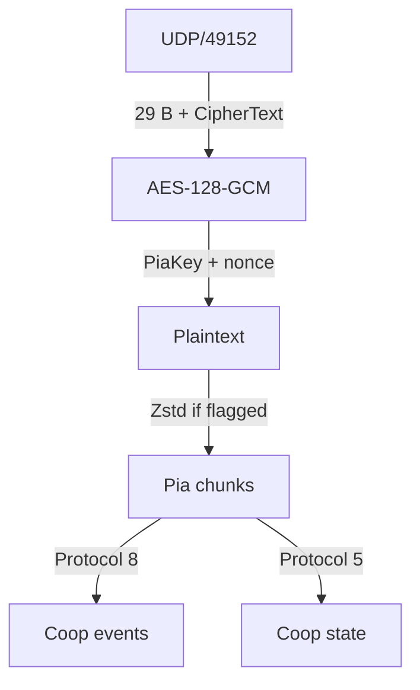

# Packet

オオモノシャケやアイテムの生成通知、WAVEや仲間の状態更新には、`CoopEnemySpawnNetEvent`、`CoopItemSpawnEvent`、`CoopSequenceNetState`など、`Coop`で始まる型名が使われます。ここではこれらをCoop通信と呼びます。

本章ではCoop通信のプロトコルについて解説します。

## パケット構造 {#packet-layout}

プライベートバイトのゲーム中の通信は、UDP 49152でやり取りされます。共通の構造をUDPペイロードのHex Viewで示します。ビット位置はUDPペイロードの先頭から数えます。

<PacketHexExample kind="packetLayout" />

`Flags`には末尾のパディング長とZstd圧縮の有無が入ります。nonceは送信元IPv4アドレスの4バイトと、`Nonce Suffix`の8バイトを連結した値です。本文は部屋ごとの`PiaKey`で認証・復号し、必要ならZstdで展開します。`PiaKey`の計算方法は[Key](/protocol/key.html)にあります。

UDPペイロードからCoop通信の本文までは、次の順に読みます。

復号後には複数のPiaチャンクが入ることがあります。各チャンクには`Protocol`番号、長さ、本文があり、省略された欄は前のチャンクの値を引き継ぎます。以下のHex Viewは、チャンクのヘッダーを除いた`Protocol`ペイロードを表示します。

## `BroadcastEventProtocol` {#event-layout}

[Type](/protocol/type.html#protocol-8)

待機中のステージとキケン度は[`PrivateSetting`](/protocol/index.html#private-setting)で更新されます。WAVE開始前には、ホストからクライアントへ別の`OnlineCoopSetting`が届きます。

表示中の型付き通知の形式では、復号後の`Protocol`ペイロードのbyte 17–20に`Group ID`、byte 21–24に型IDがあり、どちらもリトルエンディアンです。`Group ID`は配送先の通信groupを選ぶ値です。受信側は登録されたgroupを選び、その中で通知を処理します。本文の長さとメッセージ長を照合してから、その型のフィールドを読みます。`Protocol` 8には外側ヘッダーの長さが異なる形式もあるため、先に形式を判別します。

### `OnlineCoopSetting` {#online-coop-setting}

| パラメータ | 意味 |
| --- | --- |
| `Stage Resource` | `Cop_*`名。[対応表](/ids/index.html#stages)から`StageId`を求めます |
| `JobType` | バイトの種類を示します |
| `UnlockedSeason` | 通信値から`1`を引いて求めます。シーンへ反映されると、ブキ候補のSeason上限として使われます |
| `WeaponId Count`・`WeaponId[0]`～`WeaponId[3]` | ブキID配列の要素数と各要素の通信値。`WeaponId`は通信値から`3`を引いて求めます |
| `ScenarioAppVersion` | シーンの同名の値に対応する32ビット値。シーンへ反映され、`IsUseScenario`が有効な場合は装備候補の分岐に使われます |
| `ScenarioCompetitionType` | シーンへ反映されると、スペシャル再配置の判定条件の一つになります |
| `ScenarioOriginalWeaponIdArray Count` | スペシャル再配置で比較する元ブキ配列の要素数です |
| `Difficulty` | 難易度。通信値から`1`を引いて求めます |
| `GameSeed[0]`～`GameSeed[3]` | 128ビットの`GameSeed`です |
| `Unknown` | 用途を確定できていない欄 |
| `GameFrame`・`LifeNumber` | 本文の後に付くゲーム内の値 |

`OnlineCoopSetting`には`GameSeed`より前にブキIDの配列があります。表示中の211バイト形式では、復号後の`Protocol`ペイロードのbit 725–727が要素数、bit 728から各要素を16ビットで送ります。最大4件を収め、要素数を超える未使用枠はゼロで埋めます。送信時にはリングの先頭から論理順に並べ、受信側は先頭をindex 0として再構築します。シーンへこの設定を採用する経路でも要素の順序を保ちます。この配列と各プレイヤーの現在装備との対応は未確認です。

この配列には固定ブキのIDが入ります。`-1`は主ブキ生成で抽選を行う経路へ進む値なので、その枠の各WAVEの支給結果は別途計算します。[WAVE 情報](/wave/index.html#weapons-specials)では、`GameSeed`とシーン設定を使ったブキ・スペシャルの計算を説明しています。

表示中の形式では、bit 1591が`ScenarioCompetitionType`に対応し、bit 1592–1594が`ScenarioOriginalWeaponIdArray`の要素数です。後者の各要素は、ブキIDに`3`を加えた16ビット値です。未使用枠はゼロで埋められ、この配列全体は67ビットです。シーンへ反映されると、この配列はスペシャル再配置で現在のブキ配列と比較されます。再配置にはほかの条件もあり、パケットの値だけで実行の有無は確定できません。前段の可変長配列の要素数によって、ここに示した絶対ビット位置は変わります。

表示中の形式では、bit 1559–1590が`ScenarioAppVersion`です。この値から装備候補の分岐を判断するには、シーンへの反映と`IsUseScenario`の値も確認します。[InternalValue](/internal-value.html)で分岐条件を説明します。

この通知は`VersusSetting`のハンドラー`1`のイベントとして処理されます。受信側には、通知を待ち行列へ入れ、`OnlineCoopSetting`として復号して次のシーン設定へコピーする経路があります。送信側には、送信に使った同じ一時設定をローカルの設定欄へ直接コピーする経路があります。

<PacketHexExample kind="onlineCoopSetting" />

通信の`GameSeed`をシーン側へ条件付きで転送する処理があります。転送後の実効値は通信上の値だけでは確定できません。[WAVE 情報](/wave/index.html)で計算できる範囲を説明します。`GameSeed`の構成とシーンへの転送条件は[Splatoon 3の`GameSeed`](/prng/game-seed/sp3.html)で説明します。

### 装備と使用通知 {#equipment-events}

射撃・発動の通知型から、使用したブキの系統やスペシャルの種類を判別できる場合があります。

| 通知型 | 確認できる種類 |
| --- | --- |
| `PlayerNetEvent::BulletCharger` | チャージャー系の射撃 |
| `PlayerNetEvent::BulletSlosher` | スロッシャー系の射撃 |
| `PlayerNetEvent::BulletManeuver` | マニューバー系の射撃 |
| `PlayerNetEvent::BulletSpShockSonar` | ホップソナー |
| `PlayerNetEvent::ChariotStart`・`BulletSpChariotCannon` | カニタンク |
| `PlayerNetEvent::BulletSpTripleTornadoMother`・`BulletSpTripleTornadoGuide` | トリプルトルネード |

射撃型はブキの系統を示します。個別のIDは、[攻撃通知の`DamageReason`](#attack-event)に含まれる場合があります。また、[ユーザー設定](/packet/versus-user-setting.html)にはメイン・サブ・スペシャルのIDがあります。攻撃時の情報、ユーザー設定に保存した装備、バイト中に支給された装備は、それぞれ適用される時点が異なります。

### `CoopEnemySpawnNetEvent` {#enemy-spawn-event}

| パラメータ | 意味 |
| --- | --- |
| `Spawn X`・`Spawn Y`・`Spawn Z` | 敵の生成要求位置 |
| `SalmonId` | `CoopEnemyInfo.Type`に対応する敵種 |
| `Spawn Direction Raw` | 本文内の21ビットの圧縮方向 |
| `Predicted Slot` | 送信側が選択したプールの次スロットとして計算した値 |
| `Spawn Frame Raw` | 本文内の20ビットのフレーム通信値 |
| `Array Count` | 後続する32ビット値の配列件数 |
| `Pool Selector + 1` | 受信側で選ぶ敵プールのindexに`1`を加えた値 |
| `GameFrame` | 通知に付くゲーム内のフレーム値 |
| `LifeNumber` | actorの通信状態の世代照合に使う値 |

`SalmonId`の値と名前は[対応表](/ids/salmon-id.html)で確認できます。

<PacketHexExample kind="enemySpawn" />

一部のオオモノの生成要求位置は、ステージの出現地点候補と整合します。タワーなどは専用の地点処理を使います。

型IDは`0x0caefc01`です。表示中の形式は89バイトで、型付き本文は481ビットです。本文bit 51–71には21ビットの圧縮方向、bit 72–75には送信側が選択したプールの次スロットとして計算した値、bit 76–95には20ビットのフレーム値、bit 128–132には`SalmonId`があります。`Predicted Slot`は本文内の値で、通知末尾の`LifeNumber`とは別です。`Spawn Frame Raw`も、末尾の23ビットの`GameFrame`と区別します。bit 141–144の`Array Count`は後続する32ビット値の配列件数です。最大10件を収め、未使用枠も含めた配列要素領域は320ビットです。

本文bit 133–140の`Pool Selector + 1`は8ビットで、通信値から`1`を引いて復元します。送信側は選択した敵の識別レコードにある生成順の番号を入れ、受信側は同じ値を敵プールの選択に使います。通信値`0`は内部値`-1`へ戻り、特定の非負indexを指定する経路から外れます。非負の値にも、受信側のプール件数による範囲確認があります。

Enemy用resolverの特定の経路では、識別レコードの種別が`2`で番号`s`が非負の場合に、同じ番号から配送先の候補`2,000,000 + 10,000 × s`を作ります。このresolverが対象の通信で使われる条件は、別途確認が必要です。これは生成通知自体の`Group ID`とは別です。生成通知の配送先を、そのまま生成された敵の配送先として扱うことはできません。

`SalmonId`は敵種、`Predicted Slot`は送信側が選択したプールで次のスロット番号を計算した値です。敵を選ぶactor poolとは区別します。このプールは、選ばれた敵の`LifeNumber`componentに結び付きます。生成通知末尾の`LifeNumber`は、生成通知の配送先に付く値です。本文の予測値を受信して保持する処理と、受信側が最終的に採用するスロットは区別します。敵の個体を追跡するには、選択値から導く配送先候補と世代、通信の区切りを結びます。生成順の番号と受信側プールの並びが合う条件や、再利用・再初期化の扱いも確認が必要です。本文bit 96–127の32ビット欄の意味は`Unknown`です。

### `CoopEnemyStateEvent` {#enemy-state-event}

敵の状態と、その状態への切替が有効になるフレームを送ります。型IDは`0x4c1ecd54`、型付き本文は26ビットです。表示中の形式は32バイトで、`Protocol`ペイロードのbit 200から本文が始まります。

| パラメータ         | 意味                                     |
| ------------------ | ---------------------------------------- |
| `State + 1`        | 状態コードに`1`を加えた6ビット値         |
| `Transition Frame` | 状態切替が有効になる20ビットのフレーム値 |
| `GameFrame`        | 通知に付くゲーム内のフレーム値           |
| `LifeNumber`       | actorの通信状態の世代照合に使う値        |

<PacketHexExample kind="enemyState" />

受信側は`Transition Frame`に達すると状態切替の対象にします。通信値`0xfffff`は内部の特殊値`INT_MIN`へ戻り、フレーム待ちをせず条件を満たします。本文bit 0–5が`State + 1`、bit 6–25が`Transition Frame`です。状態`1`は敵の共通ステートマシンの`State::Die`に対応します。`State + 1`の通信値では`2`です。Hex Viewの`Die`でこの形式を確認できます。その他の状態コードの具体的な意味は`Unknown`です。

ヘビの死亡状態へ入る処理から、状態`1`と即時適用用の値を通知する経路があります。送信待ち状態やモード、所有者などの送信条件を満たすと通知します。また、受信通知を使わず、敵側の残り値がゼロになった条件から死亡状態を選ぶ経路もあります。`LifeNumber`はactorの現在の参照先から作る照合値です。通信幅の4ビットだけから16世代の周期とは決められません。生成通知の世代値を受信して保持する処理と、最終的なスロット選択を区別します。

状態通知の件数を個々の撃破数へ対応させるには、敵の配送先と世代、状態へ入った原因の照合が必要です。

死亡時のローカル通知では、敵の参照から敵種と保持した攻撃元参照を取り出します。参照の検査と参加者への変換、または分岐ごとの既定値選択を経て、参加者別・敵種別の集計を更新する経路があります。既定の先頭参加者を選ぶ経路もあるため、保持値の存在だけで実際の討伐者を一意に決めることはできません。敵設定の`Category`を引き継ぐ構築処理では、`0`が`Zako`、`1`が`Rare`です。結果の`KillNum`は、この二つのカテゴリの集計値を合計します。設定行がない場合にカテゴリ`0`で初期化する経路もあり、既定値だけで敵種を同定することはできません。実際の集計に使うカテゴリは、その後の初期化や上書きも含めた値です。

### `AttackEvent` {#attack-event}

攻撃通知には、攻撃元の種類とIDを含む`DamageReason`があります。通常のID範囲では、区分`0`がメイン、`1`がサブ、`2`がスペシャルのブキ情報を選び、IDをその情報の検索に使います。[`WeaponId`](/ids/weapon-id.html)と[`SpecialId`](/ids/special-id.html)の対応表も参照してください。

| 型                  | 型ID         |    本文長 | `Protocol`ペイロード長 |
| ------------------- | ------------ | --------: | ---------------------: |
| `AttackEvent`       | `0xf429516a` | 115ビット |               43バイト |
| `AttackEventMulti4` | `0xde1a711a` | 119ビット |               44バイト |
| `AttackEventMulti8` | `0xaef8a8b7` | 123ビット |               44バイト |

以下は型付き本文を起点とするLSB0のビット位置です。上のペイロード長は、本文が`Protocol`ペイロードのbit 200から始まる形式の値です。

| 本文bit | 幅 | 意味 |
| --- | --: | --- |
| 0–20 | 21 | 圧縮した方向ベクトル |
| 21–32 | 12 | ベクトルの大きさに関わる値 |
| 33–35 | 3 | `Unknown` |
| 36–52 | 17 | 受信先ごとに加算するダメージ寄与値。通信値から`1`を引きます |
| 53–55 | 3 | `Unknown`。通信値から`1`を引きます |
| 56–57 | 2 | `DamageReason`の区分。通信値から`1`を引きます |
| 58–61 | 4 | `Unknown` |
| 62–77 | 16 | `DamageReason`のID。通信値から`1`を引きます |
| 78・79 | 各1 | `Unknown`のフラグ |
| 80–110 | 31 | 攻撃元に関わる参照値。送受信時の変換を経て、条件により攻撃元側のフィードバック先の選択に使われます |
| 111–114 | 4 | `Unknown` |

`AttackEventMulti4`と`AttackEventMulti8`は同じ115ビットの本文に、それぞれ4ビットと8ビットを追加します。追加部分は、対象componentの受信先リストに対するビットマスクです。このリストと個々のプレイヤー・敵との対応は未確定です。本文の後に23ビットの`GameFrame`と4ビットの`LifeNumber`が続きます。

受信側は、対象の現在の`LifeNumber`を取得できる場合に通知との一致を確認します。現在値を取得できない場合の適用経路もあります。31ビットの参照値には送信側での置換や受信側での変換があるため、値だけで攻撃元プレイヤーを一意に決めることはできません。ダメージ寄与値から実際のHP減少や撃破成立を求める条件も未確定です。

IDの40000番台と50000番台には、通常のブキ情報検索より先に処理する例外があります。区分とIDだけで現在装備や攻撃者を決めることはできません。個人別のオオモノ討伐数を求めるには、配送先actor、攻撃者、同じ敵の世代、撃破成立を結ぶ必要があり、この対応はまだ`Unknown`です。

以下は型付き本文だけを示す構造例です。実パケットのヘッダーとフッターは含めず、表示のbit 0を本文の先頭とします。

<PacketHexExample kind="attackEvent" />

<PacketHexExample kind="attackMulti4" />

<PacketHexExample kind="attackMulti8" />

### `ColPaintEvent` {#col-paint-event}

衝突面への塗りを送ります。型IDは`0x4939c1ac`、型付き本文は154ビットです。本文が`Protocol`ペイロードのbit 200から始まる形式では48バイトです。位置、二つのサイズ値、二つの方向ベクトル、塗り定義、対象面を受け取り、対象の有効性を確認して塗り処理へ渡します。

以下は型付き本文を起点とするLSB0のビット位置です。

| 本文bit | 幅 | 意味・復元方法 |
| --- | --: | --- |
| 0–16 / 17–33 / 34–50 | 各17 | 塗り入力のXYZ。下位16ビット×`256 / 65535`を大きさ、最上位ビットを符号にします |
| 51–62 / 63–74 | 各12 | 二つのサイズ値。それぞれ通信値×`64 / 4095` |
| 75–89 | 15 | 方向ベクトルA。上下角7ビットと水平角8ビット |
| 90–104 | 15 | 方向ベクトルB。同じ角度形式 |
| 105–106 | 2 | `Unknown` |
| 107–112 | 6 | 塗り定義の選択値 |
| 113–115 | 3 | `Unknown` |
| 116–136 | 21 | 塗り模様の乱数処理への入力 |
| 137–140 | 4 | `Unknown` |
| 141–153 | 13 | 衝突面の塗り対象を参照する値 |

通常の方向ベクトルは正規化して角度に圧縮します。上下角は符号1ビットと大きさ6ビットで、大きさの単位は`(π / 2) / 63`です。水平角は符号1ビットと大きさ7ビットで、単位は`π / 127`です。極小の入力や無限大には別の処理があります。

XYZには、対象の変換データを使う経路、そのまま渡す経路、代替行列を使う経路があります。二つのサイズ値は塗り処理の広がりに使いますが、実際の形と面積には塗り定義、模様、投影先の面も関わります。サイズ値をそのまま半径や面積として扱うことはできません。本文の後に23ビットの`GameFrame`と4ビットの`LifeNumber`が続きます。

塗り定義の選択値は、`InkTexInfo`の56種類の定義へ対応します。`0`は`Shot00`、`1`は`Shot01`、`2`は`Shot02`です。構築処理では`56`～`63`を定義`0`へ戻します。定義名はブキのIDを示すものではありません。

通常の投影深度は、定義の`HeightRangeType`で決まります。二つのサイズを`A`・`B`とすると、`MinEdge`は`D = HeightRangeRate × min(A, B) / 2`、`MaxEdge`は`D = HeightRangeRate × max(A, B) / 2`を計算し、`D`と`-D`を二つの限界に使います。`Static`は設定された上限・下限、`None`は`20000`と`-20000`です。明示的な深度指定や対象面による調整は別にあり、この値だけでは最終的な塗りの輪郭や面積を求められません。

衝突面用の描画経路には、対象の情報で位置の2成分を補正し、2×3のアフィン係数で描画用座標へ変換する処理があります。条件に応じて`200`または`400`倍します。対応する対象エントリーを取得できる場合は、その中心座標でさらに補正します。オブジェクト用は別の経路を選ぶため、この変換を`ObjPaintEvent`へ一律に適用しません。

選択した模様は対応するテクスチャへ結び付き、二つのサイズなどから作る投影行列とともに描画処理へ渡します。シェーダーの具体的な処理や対象面への適用と、最終的な輪郭との対応は未確定です。

以下は型付き本文だけの構造例で、表示のbit 0が本文の先頭です。

<PacketHexExample kind="colPaint" />

### `ObjPaintEvent` {#obj-paint-event}

オブジェクトへの塗りを送ります。型IDは`0xe3f0eb9a`、型付き本文は155ビットです。本文が`Protocol`ペイロードのbit 200から始まる形式では48バイトです。

本文bit 0–140は[`ColPaintEvent`](#col-paint-event)と共通です。bit 141–148は8ビットのオブジェクト参照値、bit 149–154は6ビットの`Unknown`です。受信側はオブジェクトの有効性を確認して塗り処理へ渡します。対象の状態に応じた座標変換と塗り範囲の条件も`ColPaintEvent`と共通です。

<PacketHexExample kind="objPaint" />

### `CoopItemSpawnEvent` {#item-spawn-event}

| パラメータ | 意味 |
| --- | --- |
| `Spawn X`・`Spawn Y`・`Spawn Z` | アイテムの生成要求位置 |
| `Transform Value` | 座標変換に関わる値。`0`なら先頭のXYZをそのまま使う経路があります |
| `Link Byte`・`Link Nibble` | 後続の取得応答と結ぶ対応値の構成要素 |
| `Link Bits` | `Link Nibble`と一致する例があります。ゲーム内での意味は未確認です |
| `Other X`・`Other Y`・`Other Z` | 別の座標。用途は未確認です |
| `GameFrame` | 通知に付くゲーム内のフレーム値 |
| `LifeNumber` | 通知に付く値。ゲーム内の意味は未確認です |

確認した通信では`Link Nibble`を24ビット左へずらして`Link Byte`を加えると、後続の取得応答の`Link Value`と一致します。

<PacketHexExample kind="itemSpawn" />

### `CoopItemResponseGetByPlayerEvent` {#player-get-event}

| パラメータ   | 意味                                                    |
| ------------ | ------------------------------------------------------- |
| `Link Value` | 先に届いたアイテム生成通知との対応値                    |
| `Value + 1`  | 元の値に`1`を加えて記録した値。元の値の意味は未確認です |
| `Unknown`    | 用途未確認の値                                          |
| `GameFrame`  | 通知に付くゲーム内のフレーム値                          |
| `LifeNumber` | 通知に付く値。ゲーム内の意味は未確認です                |

<PacketHexExample kind="playerGet" />

`Protocol`ペイロードのbit 268–269にある2ビットの`Unknown`は、`1`が新しいアイテムID、`0`が先行するIDの繰り返しに対応する例があります。この`1`を取得として数え、射出と直接納品を差し引くと、所持数の候補は0または1になります。画面表示との同期と再送の扱いを検証するまで、確定した所持数にはしません。

### `CoopItemResponseGetByEnemyEvent` {#enemy-get-event}

| パラメータ   | 意味                                     |
| ------------ | ---------------------------------------- |
| `Link Value` | 先に届いたアイテム生成通知との対応値     |
| `Unknown`    | 用途未確認の値                           |
| `GameFrame`  | 通知に付くゲーム内のフレーム値           |
| `LifeNumber` | 通知に付く値。ゲーム内の意味は未確認です |

<PacketHexExample kind="enemyGet" />

### `CoopItemGoldenIkuraShotEvent` {#golden-ikura-shot-event}

| パラメータ | 意味 |
| --- | --- |
| `XYZ A X`・`XYZ A Y`・`XYZ A Z` | `1`組目の座標。射出中の役割は未確認です |
| `Vector A`・`Vector B` | 空間ベクトルの方向に由来する値 |
| `Vector Length` | 空間ベクトルの大きさに由来する値 |
| `XYZ B X`・`XYZ B Y`・`XYZ B Z` | `2`組目の座標。射出中の役割は未確認です |
| `Value + 1` | 元の値に`1`を加えて記録した値。用途は未確認です |
| `GameFrame` | 通知に付くゲーム内のフレーム値 |
| `LifeNumber` | 通知に付く値。ゲーム内の意味は未確認です |

<PacketHexExample kind="goldenShot" />

射出通知に続く`CoopItemShootSleepEvent`が同じアイテムIDを持つ場合は、この後続通知を別の所持数減少として重ねて数えません。射出通知のIDは先行する取得応答のIDと常に一致するわけではなく、すべての通知を一つのIDだけで追跡できるとは判断していません。

### `CoopItemGoldenIkuraDirectBankEvent` {#golden-ikura-direct-bank-event}

| パラメータ | 意味 |
| --- | --- |
| `Value + 1` | 元の値に`1`を加えて記録した値。金イクラの個数や納品したプレイヤーを示すかは未確認です |
| `GameFrame` | 通知に付くゲーム内のフレーム値 |
| `LifeNumber` | 通知に付く値。ゲーム内の意味は未確認です |

<PacketHexExample />

この通知だけを納品の合計とすると、投げた金イクラに続く納品を取りこぼします。直接納品通知と`CoopItemShootSleepEvent`の後には、後述の状態配列がそれぞれ1増える対応があります。

### `CoopSeqPlayerGoldenIkuraAssistEvent` {#golden-ikura-assist-event}

金イクラの納品をアシストした参加者を通知します。型IDは`0x85c563d8`、型付き本文は4ビットです。表示中の形式は29バイトで、`Protocol`ペイロードのbit 200–203が本文です。

| パラメータ    | 意味                                             |
| ------------- | ------------------------------------------------ |
| `Assist Mask` | アシストした内部参加者indexを示す4ビットのマスク |
| `GameFrame`   | 通知に付くゲーム内のフレーム値                   |
| `LifeNumber`  | 通知に付く世代の値                               |

<PacketHexExample kind="goldenAssist" />

`Assist Mask`のbit `i`が`1`なら、内部参加者index `i`がアシスト対象です。金イクラを持った参加者のビットを記録し、納品時に納品者本人のビットを取り除いて通知します。各対象の集計値は`AssistGoldenIkuraNum`へつながります。加算量にはモードによる補正があります。

同じ通知の再受信を別のアシストとして加算すると過大集計になるため、結果数を再構築するときは通信層の配送単位と重複を扱う必要があります。

### `PlayerNetEvent::CoopRescued` {#coop-rescued-event}

救助者を4ビットで通知します。型IDは`0xcf9be194`です。表示中の形式は29バイトで、`Protocol`ペイロードのbit 200–203が本文です。

| パラメータ          | 意味                                   |
| ------------------- | -------------------------------------- |
| `Rescuer Index + 1` | 救助者の内部参加者indexに`1`を加えた値 |
| `GameFrame`         | 通知に付くゲーム内のフレーム値         |
| `LifeNumber`        | actorの通信状態の世代照合に使う値      |

<PacketHexExample kind="coopRescued" />

被救助者はイベントを保持するactor/resourceから求めます。救助処理は救助者の`RescuedNum`と被救助者の`RescueeNum`を別々に更新します。通信値`0`はindex `-1`に戻り、救助者を指定しません。この経路もあるため、通知件数と個人の救助数は常に同じではありません。

通常のサーモンランで有効ステーションの論理位置が`0`から連続し、[同じ部屋の全員と内部indexの対応](/protocol/type.html#protocol-11)が取れている場合、通常のresource groupが`200000 + 10000 × index`となる経路では被救助者も対応付けられます。有効位置に欠けがあると、論理位置を使う分岐と内部indexを使う分岐が一致するとは限らず、この式だけでは個人へ割り当てられません。

通知から個人の観測数を求めるときは、同じゲーム内の現在のresource世代と`LifeNumber`を照合し、十分に新しいプレイヤー状態に結び付くものだけを数えます。同じresource・世代・`LifeNumber`・`GameFrame`の再受信は重ねて加算しません。救助者と被救助者はともに有効な別人である必要があり、指定なし・範囲外・自分自身の通知は個人へ加算しません。対応を確認できない場合の値は`Unknown`です。

この集計は、観測できた条件付きの救助通知数です。受信後のactor状態などによる適用条件や未取得の通信もあるため、最終結果の`RescuedNum`・`RescueeNum`とは区別します。観測数`0`も、そのゲームを観測している区間で該当通知がなかったことを示します。

### `PlayerNetEvent::TroubleDie` {#trouble-die-event}

型IDは`0x89e91844`、型付き本文は78ビットです。本文が`Protocol`ペイロードのbit 200から始まる形式では39バイトです。主体はイベントを保持するactor/resourceから求めます。

本文bit 0–50は17ビット×3の座標で、actorからコピーします。各成分は下位16ビット×`256 / 65535`を大きさ、最上位ビットを符号にします。後続はbit 51–54が4ビット、bit 55が1ビット、bit 56–57が2ビット、bit 58–61が4ビット、bit 62–77が16ビットです。4ビット・2ビット・16ビットの各整数は通信値から`1`を引きます。後続欄のゲーム内の意味は`Unknown`です。

以下は型付き本文だけの構造例です。

<PacketHexExample kind="troubleDie" />

### `PlayerNetEvent::Revival` {#revival-event}

型IDは`0x74400e72`、型付き本文は110ビットです。本文が`Protocol`ペイロードのbit 200から始まる形式では43バイトです。

本文bit 0–50は`TroubleDie`と同じ17ビット×3の座標形式です。bit 51–66は16ビットの整数、bit 67–91は12ビットと13ビットからなる圧縮ベクトル、bit 92–100と101–109は各9ビットの整数です。後続欄の役割は`Unknown`です。`TroubleDie`と`Revival`は本文の後に23ビットの`GameFrame`と4ビットの`LifeNumber`を持ちます。

適用条件を満たした`Revival`の受信処理は、選択中のシーンの`Scene_Coop`プロパティを保持した値から内部modeを選びます。値が真ならmode`5`、ゼロならmode`0`です。mode`5`の処理は`PlayerCoopZombie`のフラグを立て、`PlayerCollision`が選ぶ衝突オブジェクトを`ColBullet_CoopZombie`へ切り替えます。`CoopRescued`の共通処理は、立っている同じフラグを解除し、選択を通常の`ColBullet`へ戻します。このmodeは受信処理側で選ぶ値で、上の本文にmode欄があるという意味ではありません。フラグと`PlayerNetState`の特定ビットとの対応、画面上の浮き輪状態との最終的な対応は`Unknown`です。

`Revival`と、救助者を指定する`CoopRescued`は別の通知です。通知名だけで一律に生存状態へ切り替えると、この条件付きの遷移を扱えません。復帰通知の件数と救助者の結果数も区別します。

<PacketHexExample kind="revival" />

## `UnreliableProtocol` {#state-layout}

[Type](/protocol/type.html#protocol-5)に、確認した状態の型を載せています。

明示的なフレーム形式で確認した`Group ID`は`1104`、`1107`、`1108`、`200000`、`210000`です。別のフレーム形式には、以下のビット位置をそのまま適用しません。

### `CoopSequenceNetState` {#wave-state}

| パラメータ | 意味 |
| --- | --- |
| `Frame Mode` | 明示的なフレーム形式を示す値 |
| `Frame Length` | フレームの長さ |
| `Group ID` | `1104`。ホストからクライアントへ送信 |
| `Present` | 状態の有無 |
| `Sequence` | WAVE進行に関わる値。画面のWAVE番号との対応は未確認です |
| `Quota` | 適用ノルマの値 |
| `Baseline A`・`Baseline B` | 集計の基準値。現在の金イクラ数かは未確認です |
| `Next Frame Length` | 後続する状態フレームの長さ |
| `Next Group ID`・`Next Present` | `1107`の状態フレームと、その状態の有無 |
| `Frame 3 Length`・`Frame 3 Group ID`・`Frame 3 Present` | さらに続く`200000`の状態フレームの長さと、その状態の有無 |
| `Unknown` | `1104`本文末尾の1ビットと、後続フレームの未解釈値 |

<PacketHexExample kind="sequence" />

表示中の形式では、bit 75は`1104`本文の末尾です。bit 76から次の`1107`フレームの長さが始まります。

`Sequence=0/1/2`への変化は、それぞれWAVE 1/2/3の進行と整合します。WAVEの境界は状態更新と画面表示の照合が必要です。

### `CoopSeqPlayerNetState` {#players}

個人の通常イクラ数と保持中の金イクラ数、全参加者の金イクラ納品数を送ります。正常な型付き本文は189ビットで、`Group ID`と`Present`を含む明示的なフレームは222ビットです。

| パラメータ | 意味 |
| --- | --- |
| `Group ID` | `1107`は内部index 0、`1108`は内部index 1の集計状態 |
| `Present` | 状態の有無 |
| `IkuraNum` | この状態の参加者が獲得した通常イクラ数 |
| `HeldGoldenIkuraNum` | この状態の参加者が保持中の金イクラ数 |
| `Array A Count`・`Array B Count` | 各配列の有効な値の件数。最大4件 |
| `Array A [0]`～`Array A [3]` | 内部参加者index順のWAVE内金イクラ納品数 |
| `Array B [0]`～`Array B [3]` | 同じindex順の累計金イクラ納品数。`GoldenIkuraNum`に対応 |
| `Sequence` | 通信値から`1`を引いて求める進行値 |
| `GameFrame` | 20ビットのフレーム値。`0xfffff`は特殊値`INT_MIN` |
| `Next Frame Length`・`Next Group ID`・`Next Present` | 後続状態フレームの長さ、group、状態の有無 |
| `Position X`・`Position Y`・`Position Z`、`Basis Z Pitch Raw`・`Basis Z Yaw Raw`、`Basis Y Input Pitch Raw`・`Basis Y Input Yaw Raw`、`Horizontal Angle Raw`、`Direction Float Raw`、`Current State Label + 1`、`PlayerStepPaint State`、`PlayerStepPaint Index + 1`、`Squid/Human Select`、`Squid State`・`Human State` | 後続する[`PlayerNetState`](#player-net-state)の値 |
| `Unknown` | 用途を確定していない欄 |

`1107`と`1108`は内部参加者indexへ固定して割り当てます。先頭の二つの数はそのindexの個人値ですが、配列は全参加者の値を含みます。画面上のプレイヤー番号との対応は別に確認します。

<PacketHexExample kind="playerState" />

型付き本文を起点とすると、bit 0–13が`IkuraNum`、bit 14–25が`HeldGoldenIkuraNum`です。配列Aはbit 26–28の件数とbit 29–76の4枠、配列Bはbit 77–79の件数とbit 80–127の4枠から成ります。各枠は12ビットです。要素は内部リングの論理先頭から送られ、通常の生成処理では内部参加者index順に並びます。件数が4未満でも未使用枠をゼロで埋めるため、後続欄の位置は変わりません。

納品時は保持数を消費し、モード補正後の量を配列A・Bの対応値へ加算します。WAVE準備では保持数と配列Aをゼロへ戻し、配列Bを保持します。同じゲーム内で配列Bを受信すると、参加者ごとに現在値と受信値の大きい方を保持します。複数の送信元の値を重ねて合算したり、遅れて届いた小さい値で累計を戻したりしません。配列Bの累計は新しいゲームで区切ります。

本文bit 128–130が`Sequence`、bit 131–132が`Unknown`、bit 133–152が`GameFrame`です。bit 153–178には、入力された位置とシーン上の基準位置との3D距離を累積する値を送ります。納品処理では金イクラの位置を入力に使います。通信値は`(値 + 99999) × 256`に由来しますが、基準位置とゲーム内での正式な項目名は`Unknown`です。末尾bit 179–188の10ビット値も`Unknown`です。

通常の所有者判定では、内部参加者indexをステーションring上の所有者へ変換し、ローカルのステーションと一致した場合に状態を更新して送信候補にします。受信した本文を復号する処理は、この印を付けません。

### `PlayerNetState` {#player-net-state}

下のHex Viewは、`1107/1108`と後続のプレイヤー状態を含む`Protocol`ペイロードをそのまま表示します。三つの17ビット値は後続フレームの本文にあり、`1107/1108`の本文には含まれません。

明示的なフレーム形式では、`1107`の次に`200000`、`1108`の次に`210000`が続く場合があります。どちらもフレーム長は619ビットで、32ビットの`Group ID`、1ビットの`Present`、586ビットの`PlayerNetState`本文に分かれます。プレイヤーactorの通信設定からこの型の生成・登録・符号化までつながっており、`UnreliableProtocol`で送ります。本文の先頭は三つの17ビット値です。

この読取経路で基準groupが`200000`となる分岐では、ステーションringの論理走査位置の`10000`倍を足します。その分岐の`210000`は論理走査位置1に対応しますが、この位置から装備抽選の内部indexや画面上のプレイヤー番号は決まりません。

`210000`が`1108`に続く109バイト形式では、三つの値は`Protocol`ペイロードのbit 280–330です。`200000`が`1104`・`1107`に続く118/138バイト形式ではbit 355–405です。各値は下位16ビットを`256 / 65535`倍し、最上位の1ビットで符号を決めます。これらは受信側でプレイヤーactorの位置に適用されます。移動床に応じた座標変換や補間もあるため、各通信値と表示上のワールド座標を結ぶ際は適用経路を扱います。画面上のP1～P4との対応は未確認です。

本文bit 51–83と84–116には、方向と大きさを送る二つのベクトルがあります。Hex Viewでは`Vector A`・`Vector B`の各`Pitch Raw`・`Yaw Raw`・`Length Raw`として分けて表示します。

| ベクトル   | 上下角10ビット | 水平角11ビット | 大きさ12ビット |
| ---------- | -------------- | -------------- | -------------- |
| `Vector A` | 51–60          | 61–71          | 72–83          |
| `Vector B` | 84–93          | 94–104         | 105–116        |

方向の角度形式は後述の回転基底と共通です。大きさは通常の有限値について、おおむね`floor(length × 60 × 4095 / 128)`を上限`4095`に収めて送ります。復号時の大きさは`raw / 4095 × 128 / 60`です。実際の計算にはfloatの丸めが入り、極小の入力は大きさ`0`になります。二つのベクトルが速度や加速度のどの値に対応するかは`Unknown`です。

本文bit 117–137と138–158には、プレイヤーの回転基底を再構成する二つの方向ベクトルがあります。Hex Viewでは、それぞれ`Basis Z Pitch Raw`・`Basis Z Yaw Raw`、`Basis Y Input Pitch Raw`・`Basis Y Input Yaw Raw`と表示します。各ベクトルは10ビットの上下角と11ビットの水平角です。上下角は符号1ビットと大きさ9ビットで、単位は`(π / 2) / 511`、水平角は符号1ビットと大きさ10ビットで、単位は`π / 1023`です。通常の入力は正規化して送り、大きさは保持しません。

受信側には、二つのベクトルの内積の絶対値が約`0.99`未満の場合に、基底を組み直す経路があります。先のベクトルを正規化してZ軸とし、後のベクトルとZ軸の外積からX軸、Z軸とX軸の外積からY軸を作ります。この説明は通常の非退化入力に対する処理です。後続のモデル側の補正を含む最終的な表示姿勢との対応は、さらに確認が必要です。

`spl::PlayerNetState`の書込処理では、本文bit 159–171が別の3Dベクトルの水平成分から作る13ビットの角度です。上記の109バイト形式では`Protocol`ペイロードのbit 439–451、118/138バイト形式ではbit 514–526に当たります。この角度は移動差分から推定する値ではなく、プレイヤーの方向ベクトルから作り、受信側で角度を補間して同じ状態へ戻します。本文bit 172–183には付随するfloat値があり、通信値を`2 / 4095`倍して`1`を引くと-1～1の値に戻ります。Hex Viewではそれぞれ`Horizontal Angle Raw`と`Direction Float Raw`です。身体の向きと射撃方向のどちらへ対応するかは`Unknown`です。

同じ書込処理の本文bit 318はサブ状態の選択値で、`0`が`PlayerNetState_Squid`、`1`が`PlayerNetState_Human`です。109バイト形式ではbit 598、118/138バイト形式ではbit 673に当たります。この選択値の後は、両形式とも10ビットの領域を使います。イカ形式は本文bit 319–321の3ビットとbit 322–328のゼロ埋め、ヒト形式はbit 319–328の10ビットです。次の選択値はどちらもbit 329から始まります。Hex Viewでは有効部分を`Squid State`または`Human State`、未使用部分を`Padding`と表示します。ヒト形式の本文bit 319–321は、それぞれ内部カウンターが正かどうかを送ります。受信処理ごとに対応カウンターを`4`減らしてゼロを下限にし、受信値が`1`なら最低`4`まで戻します。同じ形式のbit 324–326も、別の内部カウンターの正値判定を送ります。bit 326は受信側で二つのカウンターの更新に使います。bit 322・323は複数の条件を組み合わせた真偽値で、受信後に別のカウンターを加算するかゼロへ戻す処理があります。各カウンターのゲーム内での用途は`Unknown`です。末尾のbit 327–328は内部のbyteの下位2ビットです。内部値が`0`～`3`のとき、`ToSquid`または`ToSquid_Chariot`を対象とする処理の戻り値bit 0が立つ条件で、`(value + 1) % 4`へ進める経路があります。受信側は同じbyteへ条件付きで書き戻します。この戻り値には要求の保存・転送段階で立つ経路があるため、実際の変身完了回数を示す値とは確認できません。用途を特定していない欄はHex Viewでも`Unknown`と表示します。イカ形式の先頭1ビットと続く2ビットは別々の状態値として書き戻しますが、その意味も`Unknown`です。

後続には、型を選ぶ小さな整数と固定長の領域を組み合わせた三つの分岐があります。各型の本文が短くても残りをゼロで埋めるため、後続の開始位置は変わりません。選択値は分岐内の番号で、型を識別する内部の32ビット値とは別です。末尾の欄は本文bit 463から続きます。

本文bit 280–282は`PlayerStepPaint State`で、足元の塗りに関わる`PlayerStepPaint`の状態値です。bit 283–285は`PlayerStepPaint Index + 1`で、同componentが選択した塗りのindexに`1`を加えて送ります。状態値は内部の量と補助条件によって`0/1`・`2/3`・`4/5`に分かれます。indexには、状態に応じて現在のindexを使う経路と、三つの塗りの寄与を比較して選ぶ経路があります。条件によって以前の値を保持します。各状態値の名称とindexのチーム名への対応は`Unknown`です。生存状態のフラグはまだ特定できていません。本文bit 304–308の`Current State Label + 1`は、actorの現在の参照先に付く照合値に`1`を加えた5ビット値です。通信値`0`は復号後の`−1`に対応します。受信側はローカルの照合値と比較し、異なる場合には別の内部条件に従って後続の適用を見送ります。P8の`LifeNumber`を作る処理も同じメンバー構成の参照を使いますが、負値や参照先なしを`0`へ変換し、下位4ビットを送る点が異なります。

専用のHex Viewでは、ヒト形式のbit 319–321・324–326を`Human Counter Positive`、イカ形式の先頭1ビットを`Squid Flag`と表示します。これらを生存・死亡のフラグとは確定していません。

<PacketHexExample kind="playerNetState" />

ヒト・イカの分岐を切り替える構造例も示します。この表示は本文bit 318–328の部分だけで、表示内のbit 0が本文bit 318に当たります。イカ形式の未使用7ビットと、ヒト形式の8個の真偽値・末尾2ビットの違いを確認できます。

<PacketHexExample kind="playerForms" />

本文bit 329–331の選択値に続くbit 332–439は108ビットの領域です。次の五つの型が登録されています。

| パラメータ             | 意味                                            |
| ---------------------- | ----------------------------------------------- |
| `Variant Select` = `0` | `Jump`。本文108ビット、`Padding` 0ビット        |
| `Variant Select` = `1` | `DokanWarp`。本文1ビット、`Padding` 107ビット   |
| `Variant Select` = `2` | `Sitting`。本文5ビット、`Padding` 103ビット     |
| `Variant Select` = `3` | `RespawnLand`。本文64ビット、`Padding` 44ビット |
| `Variant Select` = `4` | `DeckEdit`。本文0ビット、`Padding` 108ビット    |

`Jump`の108ビットは次のように分かれます。表の位置は`PlayerNetState`本文を基準にしています。

| 本文bit | ビット数 | フィールド | 形式 |
| --- | --- | --- | --- |
| 332 | 1 | `Unknown` | 真偽値 |
| 333–356 | 24 | `Unknown` | 復号値は`raw / 65536 − 100` |
| 357–380 | 24 | `Unknown` | 復号値は`raw / 65536 − 100` |
| 381–413 | 33 | `Jump Vector` | 上下角10ビット・水平角11ビット・大きさ12ビット |
| 414–438 | 25 | `Unknown` | 復号値は`raw / 65536 − 200` |
| 439 | 1 | `Unknown` | 真偽値 |

`Jump Vector`は上の`Vector A`・`Vector B`と同じ圧縮形式です。生成時には元のベクトルのY成分を`0`にし、その元のY成分を別の値へ加算して本文bit 357–380の数値として送ります。末尾の真偽値には、現在のフラグと内部値の条件を満たした場合に処理を開始する経路があります。数値の用途、各フラグの生存・死亡や接地との対応、この型の選択と画面上のジャンプ動作との対応は`Unknown`です。

`RespawnLand`の本文は、17ビット×3のベクトル値、10ビット値、3ビット値からなります。受信処理はベクトル値を書き戻し、3ビット値が現在値と同じ場合に10ビット値を適用します。異なる場合は専用の遷移処理へ進みます。ベクトルの用途と各3ビット値のゲーム内での意味は`Unknown`です。

`PlayerCoopZombie`のフラグを読む遷移処理には、この3ビット値の元となる値を`1`へ設定する経路があります。フラグが無効な場合にも`1`へ設定する経路があるため、値だけで生存・死亡を判定する対応は未確定です。この値を送るのは、別の同期条件を満たして`RespawnLand`形式が選ばれた場合です。`Revival`で使う内部のモード`5`と、この本文の3ビット値`5`は区別します。

下の構造例は選択値と固定領域を表示します。用途を特定していない本文は`Unknown`、型ごとの未使用領域は`Padding`です。

<PacketHexExample kind="playerActionStates" />

本文bit 440–443の選択値に続くbit 444–459は16ビットの領域です。`InkAction`の型はブキなどの動作系統を表します。この選択値から具体的な`WeaponId`を一意に求める対応は未確定です。

| パラメータ | 意味 |
| --- | --- |
| `Variant Select` = `0` | `InkActionNone`。本文0ビット、`Padding` 16ビット |
| `Variant Select` = `1` | `InkActionShooter`。本文1ビット、`Padding` 15ビット |
| `Variant Select` = `2` | `InkActionRoller`。本文8ビット、`Padding` 8ビット |
| `Variant Select` = `3` | `InkActionCharger`。本文15ビット、`Padding` 1ビット |
| `Variant Select` = `4` | `InkActionSpinner`。本文13ビット、`Padding` 3ビット |
| `Variant Select` = `5` | `InkActionSlosher`。本文5ビット、`Padding` 11ビット |
| `Variant Select` = `6` | `InkActionBrush`。本文11ビット、`Padding` 5ビット |
| `Variant Select` = `7` | `InkActionManeuver`。本文2ビット、`Padding` 14ビット |
| `Variant Select` = `8` | `InkActionShelter`。本文13ビット、`Padding` 3ビット |
| `Variant Select` = `9` | `InkActionStringer`。本文9ビット、`Padding` 7ビット |
| `Variant Select` = `10` | `InkActionSaber`。本文6ビット、`Padding` 10ビット |
| `Variant Select` = `11` | `InkActionSpChariot`。本文14ビット、`Padding` 2ビット |
| `Variant Select` = `12` | `InkActionSpNiceBall`。本文10ビット、`Padding` 6ビット |
| `Variant Select` = `13` | `InkActionSpCastle`。本文16ビット、`Padding` 0ビット |
| `Variant Select` = `14` | `InkActionGachihoko`。本文1ビット、`Padding` 15ビット |

下の構造例は選択値と固定領域を表示します。用途を特定していない本文は`Unknown`、型ごとの未使用領域は`Padding`です。

<PacketHexExample kind="playerInkActions" />

本文bit 460–461の選択値に続くbit 462は1ビットの領域です。`InkActionNone`では、この1ビット全体が`Padding`です。

| パラメータ | 意味 |
| --- | --- |
| `Variant Select` = `0` | `InkActionNone`。本文0ビット、`Padding` 1ビット |
| `Variant Select` = `1` | `InkActionBombFizzy`。本文1ビット、`Padding` 0ビット |
| `Variant Select` = `2` | `InkActionSuperHook`。本文1ビット、`Padding` 0ビット |

下の構造例は選択値と固定領域を表示します。用途を特定していない本文は`Unknown`、型ごとの未使用領域は`Padding`です。

<PacketHexExample kind="playerAuxActions" />

## `BroadcastReliableProtocol` {#reliable-state-layout}

### `StationInfo` {#station-info}

ステーションごとのユーザー設定を同期します。ハンドラー番号はステーションの論理indexに`2`を加えた値です。`Reliable`の各要素は有無の1ビットを持ち、存在する要素だけ本文が続きます。

| 位置（0起点） | 要素 | 本文長 |
| --: | --- | --: |
| 0 | `sequence_id` | 3ビット |
| 1 | `is_valid` | 1ビット |
| 2 | `is_ready` | 1ビット |
| 3 | `user_setting_cnt` | 16ビット |
| 4 | `station_update_count` | 20ビット |
| 5 | `StationNetState` | 696ビット |
| 6 | [`VersusUserSettingNetState`](/packet/versus-user-setting.html) | 1695ビット |
| 7 | `CoopUserInfoNetState` | 17ビット |
| 8 | `VersusUserDbgNetState` | 3ビット |
| 9 | `bottleneck_player_bitmap` | 11ビット |
| 10 | [`RomInfoNetState`](#rom-info) | 通常550ビット |
| 11 | `receive_rate_suspect_bitmap` | 11ビット |

`VersusUserSettingNetState`には、メイン・サブ・スペシャルのID、ギア、外見、ネームプレート、ステータスがあります。[本文の全フィールド](/packet/versus-user-setting.html)を別ページにまとめています。本文bit 1424–1426の`GameStatus.CoopSmell`は、参加者ごとに合算して[EX WAVEの抽選](/packet/versus-user-setting.html#ex-wave)に使う3ビット値です。`CoopUserInfoNetState`は整数に`10`を加えた17ビット値ですが、ゲーム内の意味は`Unknown`です。

下の構造例は、`StationInfo`の`Reliable`要素列だけを示します。各要素のpresenceと、存在する要素の本文を順に並べ、ユーザー設定と`CoopUserInfoNetState`だけを存在させています。表示のbit 0は最初のpresenceです。`Group ID`や外側の`Protocol`ヘッダーは含みません。

<PacketHexExample kind="stationInfo" />

### `CoopUserInfoNetState` {#coop-user-info}

17ビットの通信値から`10`を引いて内部の整数値へ戻します。次の構造例はこの型の本文だけです。

<PacketHexExample kind="coopUserInfo" />

### `VersusUserDbgNetState` {#versus-user-dbg}

本文は3ビットで、通信値から`1`を引いて戻します。値のゲーム内での意味は`Unknown`です。次の構造例はこの型の本文だけです。

<PacketHexExample kind="versusUserDbg" />

### `RomInfoNetState` {#rom-info}

型の登録IDは`0x10951074`です。登録上の本文長は294～550ビットですが、配列件数が`0`～`4`の通常形式は、未使用枠もゼロで埋めるため550ビットになります。件数`0`でも配列用の256ビットの領域は残ります。

本文bit 0–223は32ビット値が七つ、bit 224は1ビット、bit 225–226は2ビットです。bit 227–229の`Array Count`に続き、bit 230–485に64ビット値を最大4件収めます。最後に、bit 486–517と518–549の32ビット値が続きます。配列件数以外の各値の用途は`Unknown`です。

| パラメータ | 意味 |
| --- | --- |
| `Array Count` | 通常形式の64ビット値の件数。`0`～`4`です |
| `Unknown` | 用途を特定していない値です |
| `Padding` | 配列の未使用領域、または550ビットの本文をバイト列に収める末尾2ビットです |

次の構造例は、この型の本文だけを表示します。件数を切り替えて、使用する配列部分とゼロ埋めの境界を確認できます。

<PacketHexExample kind="romInfo" />

## 参考資料 {#references}

- ELF
- ステージデータ
- LAN Play通信
