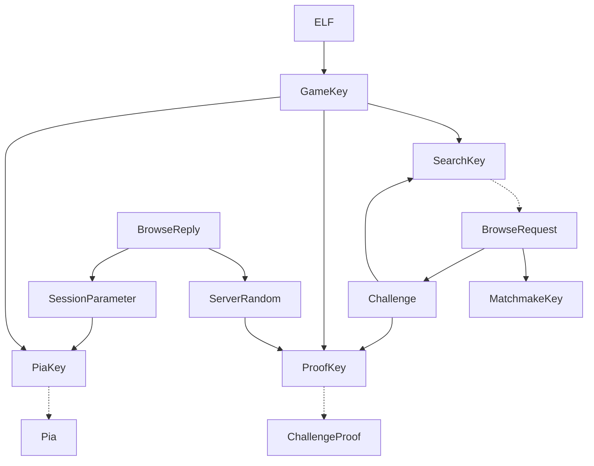

# Key

LAN Playの暗号化・認証に使う値と導出鍵の一覧です。`BrowseRequest`はクライアントが部屋を探すパケット（type 0）、`BrowseReply`はホストが返す部屋情報（type 1）です。`GameKey`はELFから計算する共通鍵で、`GameSeed`とは別です。

## 値と鍵の一覧

表中の`+`は、バイト列では連結、整数では加算を表します。

| 名前 | 長さ（ビット） | 取得元・計算方法 |
| --- | --: | --- |
| `MatchmakeKey` | `64` | `BrowseRequest[5:13]` |
| `GameKey` | `128` | ELFの初期状態・定数表から計算 |
| `Challenge` | `128` | `BrowseRequest[37:53]` |
| `SearchKey` | `128` | `AES-128-ECB(GameKey, Challenge)` |
| `ServerRandom` | `128` | `BrowseReply[572:588]` |
| `ProofKey` | `128` | `HMAC-SHA256(GameKey, ServerRandom + Challenge)[:16]` |
| `ChallengeProof` | `128` | `HMAC-SHA256(GameKey, BrowseRequestPlaintext)[:16]` |
| `SessionParameter` | `256` | `BrowseReply[105:137]` |
| `ChangedParameter` | `256` | `SessionParameter[0:31] + byte((SessionParameter[31] + 1) % 256)` |
| `PiaKey` | `128` | `HMAC-SHA256(GameKey, ChangedParameter)[:16]` |

実線は鍵の導出、点線は使用先を示します。



## `GameKey`の計算

ELF仮想アドレス`0x150836c..0x150838c`の命令から初期状態を、`0x50b8314`から64要素の定数表を読み取り、以下の手順で`GameKey`を計算します。

```rust
fn read_key_material(elf: &[u8]) -> ([u32; 4], [u32; 64]) {
    let mut x8 = 0u64;
    let mut x9 = 0u64;
    for address in (0x150836C..0x150838C).step_by(4) {
        let inst = read_u32_le_at_va(elf, address);
        let shift = ((inst >> 21) & 3) * 16;
        let value = (((inst >> 5) & 0xFFFF) as u64) << shift;
        let target = if inst & 31 == 8 { &mut x8 } else { &mut x9 };
        if inst & 0xFF80_0000 == 0xD280_0000 { // MOVZ
            *target = value;
        } else { // MOVK
            let mask = 0xFFFFu64 << shift;
            *target = (*target & !mask) | value;
        }
    }
    let state = [x8 as u32, (x8 >> 32) as u32, x9 as u32, (x9 >> 32) as u32];
    let table = read_u32_le_array::<64>(elf, 0x50B8314);
    (state, table)
}

fn get_u32(state: &mut [u32; 4]) -> u32 {
    let t = state[0] ^ (state[0] << 11);
    let value = t ^ (t >> 8) ^ state[3] ^ (state[3] >> 19);
    *state = [state[1], state[2], state[3], value];
    value
}

fn derive_game_key(mut state: [u32; 4], table: &[u32; 64]) -> [u8; 16] {
    let mut GameKey = [0u8; 16];
    for word in 0..4 {
        let mut part = 0u32;
        for _ in 0..4 {
            let index = ((get_u32(&mut state) as u64 * 64) >> 32) as usize;
            let shift = (get_u32(&mut state) >> 27) & 0x18;
            part = (part << 8) | ((table[index] >> shift) & 0xFF);
        }
        GameKey[word * 4..word * 4 + 4].copy_from_slice(&part.to_le_bytes());
    }
    GameKey
}

let (state, table) = read_key_material(elf);
let GameKey = derive_game_key(state, &table);
```

## 参考資料

- ELF
- LAN Play通信
